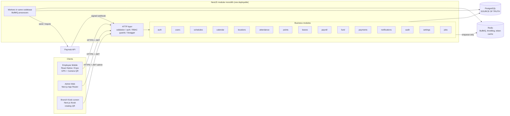
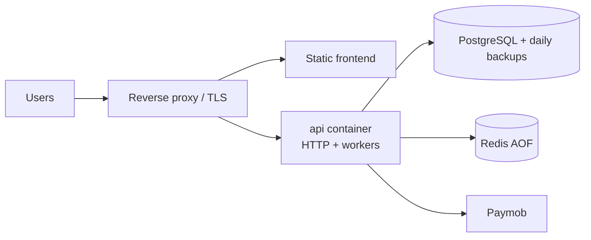

# 04 — Architecture

| Field | Value |
|---|---|
| **Version** | 3.0 |
| **Status** | Final draft — implementation-ready |
| **Last Updated** | 2026-10-08 |
| **Source of Truth** | The finalization prompt ("SoT") overrides older documents. Style: Modular Monolith; no microservices, no Kafka/RabbitMQ, no distributed event architecture (SoT §24). |

---

## 1. System Architecture



Key properties
- **One database transaction** can span points, offsets, payroll, fund and audit — this is why the system is a monolith.
- **Redis is auxiliary.** Losing Redis never loses money data; it only delays jobs.
- **External calls never run inside the main DB transaction** (see `05-SYSTEM_DESIGN.md` §14).

## 2. Layering

```text
Controller          HTTP only: DTO validation, auth guard, permission guard, status codes
   ↓
Service / Use Case  Business rules, transaction boundary, audit writes, calls other modules' services
   ↓
Repository          Database only: Prisma + raw SQL (FOR UPDATE, derived views)
   ↓
Prisma / PostgreSQL
```

Rules
1. Controllers contain no business logic and no Prisma calls.
2. Services open the transaction (`prisma.$transaction`) and pass `tx` to repositories and to other modules' **service** methods that accept a `tx`.
3. Rules are **pure functions** where possible (`classifyCheckIn`, `computeOvertimeGreens`, `planOffsets`, `calculatePayroll`) — no DB, no clock; unit-tested directly.
4. Modules never import another module's repository; they use its exported service.
5. Not every module needs all layers (e.g., `settings` is a thin service + repository).

## 3. Module Boundaries

| Module | Responsibility | Owns tables | Depends on |
|---|---|---|---|
| `auth` | Login, refresh rotation, logout, throttling, guards, RBAC foundation | `roles`, `role_permissions`, `refresh_tokens` | users, settings |
| `users` | Employees, salary versions, disable/reactivate, payout-method owner link | `users`, `employee_compensation_versions`, `user_locations` | auth(roles), audit |
| `schedules` | Shift + versioned ShiftVersion + ShiftAssignment, effective-schedule resolver | `shifts`, `shift_versions`, `shift_version_weekdays`, `shift_assignments` | users, audit |
| `calendar` | Weekly off days, holidays, off-day-work exceptions, `isWorkingDay` | `holidays`, `work_offers` (type `OFF_DAY_WORK`) | settings, audit |
| `locations` | Geofences, QR token generation/validation | `locations` | audit |
| `attendance` | Check-in (GPS+QR), check-out, absence handling, corrections, verification expiry | `attendance`, `attendance_verifications` | schedules, calendar, locations, leaves, points, audit |
| `points` | Point ledger, offset engine, reversals, derived point state | `point_transactions`, `point_offsets`, `point_value_versions` | settings, payroll(lock check), audit |
| `leaves` | Leave + early-leave requests and decisions | `leave_requests`, `early_leave_requests` | calendar, attendance, points, notifications, audit |
| `payroll` | Calculator, preview, Month Close, adjustments, month lock | `payroll_months`, `payroll_records`, `payroll_adjustments` | points, fund, leaves, calendar, users, settings, audit |
| `fund` | Fund ledger, balance, withdrawal use case | `fund_transactions` | payments(payouts), users(lock), audit |
| `payments` | Payout methods, payouts, Paymob adapter, webhook, processor, manual fallback | `payout_methods`, `payouts`, `payment_webhook_events` | fund, jobs(outbox), audit |
| `notifications` | In-app notifications (push is Later) | `notifications` | — |
| `audit` | Append-only audit writer/reader | `audit_logs` | — |
| `settings` | Typed key/value settings | `settings` | audit |
| `jobs` | BullMQ setup, repeatable job registration, outbox relay | `outbox_events` | all (via services) |

Dependency direction (no cycles): `settings, audit, notifications` ← `users, schedules, calendar, locations` ← `points` ← `leaves, attendance` ← `fund, payroll` ← `payments` ← `jobs`.
`attendance → points` is the only path that awards attendance points; `leaves → points` reverses Blacks; `payroll → points/fund` reads points and writes the fund credit.

## 4. Request Flow

```text
Client ─► Nest pipeline:
   1. RequestId middleware (X-Request-Id, logged)
   2. JwtAuthGuard (verifies access token)
   3. PermissionGuard (role → permissions, "own" vs "any" scope)
   4. ValidationPipe (DTO)
   5. Controller → Service (transaction, rules, audit) → Repository → PostgreSQL
   6. After COMMIT only: enqueue / notify / external calls (via outbox for money flows)
   7. Exception filter → { code, message, details, requestId }
```

## 5. Database
- PostgreSQL is the single source of truth. Migrations only (Prisma migrate + raw SQL migrations for constraints/triggers).
- Application DB role has **no UPDATE/DELETE** privilege on `point_transactions`, `point_offsets`, `fund_transactions`, `audit_logs`, `payroll_adjustments`; triggers raise on attempts as a second line of defense.
- Per-user serialization uses `SELECT … FROM users WHERE id = $1 FOR UPDATE` (the **user lock**). Lock order: `payroll_months` (if needed) → `users` ascending id → other rows.
- Schema: see `08-DATABASE_SCHEMA.md`.

## 6. Redis / BullMQ

| Queue / Job | Type | Purpose |
|---|---|---|
| `attendance-sweeper` | repeatable, every minute | Expire verifications older than 15 min; create absence Blacks (with lookback catch-up) |
| `outbox-relay` | repeatable, every ~5–10 s | Read `outbox_events` (`FOR UPDATE SKIP LOCKED`), enqueue BullMQ jobs, mark published |
| `payout` | on demand (+ delayed retries) | `send` and `inquire` jobs for payouts |
| `housekeeping` | repeatable, daily | Delete expired refresh tokens; payout "stuck > N days" alert |

Redis also stores: login throttle counters and the Paymob bearer token (TTL < 60 min). **Not** stored in Redis: balances, points, payout state.
Failure behavior: see `02-PRD.md` Edge Case 19.

## 7. Paymob
- `PayoutProvider` interface (`send`, `inquire`) with `PaymobProvider` adapter and a `FakeProvider` for tests.
- Flow: withdrawal transaction → outbox → relay → BullMQ `payout.send` → Paymob (outside any DB transaction) → webhook (hint) / inquiry (truth) → state change transaction (+ refund row on failure).
- Manual fallback: admin can inquire, and mark `PAID`/`FAILED` manually with mandatory evidence note; always audited.

## 8. Client Architecture (Web & Mobile)
- **Admin Web (Next.js App Router):** Management dashboards, employee tables, schedule assignments, leave review queues, payroll preview/close, payout monitoring, and `/kiosk` (displays the rotating HMAC QR for a branch, polling every ~20 s).
- **Employee Mobile (React Native / Expo):** Employee home status, 2-step check-in (native GPS geofence + live camera QR scan), check-out, point ledger with derived states, payroll estimate, leave requests, and fund withdrawal. Tokens secured via `expo-secure-store`.
- Both clients communicate strictly with `/api/v1`; types generated from the NestJS OpenAPI schema; zero business rules implemented client-side (server is authoritative for time, windows, points, and money).

## 9. Admin vs Employee

| Aspect | Employee | Admin |
|---|---|---|
| Role code | `EMPLOYEE` | `ADMIN` |
| Data scope | own rows only (ownership check in service) | all rows |
| Mutations audited | payout-method change, withdrawal (as payout events) | every mutation |
| Endpoints | `/attendance`, `/me/*`, `/leaves`, `/early-leaves` | `/admin/*` |

## 10. Security Architecture

| Concern | Measure |
|---|---|
| Passwords | argon2id; admin-driven reset; forced change after reset |
| Sessions | 15-min access JWT; rotating refresh with reuse detection; revoke on disable/logout |
| Authorization | Permission strings (`resource.action.scope`) mapped from role via `role_permissions`; guard + ownership check; only `ADMIN`/`EMPLOYEE` seeded |
| Attendance integrity | Server time only; GPS accuracy + geofence; rotating HMAC QR bound to location and a live verification; no static QR |
| Data protection | TLS; payout account numbers encrypted (AES-256-GCM, key from secret store); coordinates stored only at check-in/out |
| Payments | Signed webhooks verified over raw body; idempotency keys; unique `client_reference`; no payment data in logs |
| Audit | Same-transaction audit rows with before/after JSON |
| Secrets | Environment/secret store, validated at startup; never in repo |
| Abuse | Login throttling; per-user withdrawal limits (DN-13); admin alert on large withdrawals |

## 11. RBAC Foundation (without over-engineering)
- Tables: `roles(name)`, `permissions(code)`, `role_permissions(role_id, permission_id)`, `user_roles(user_id, role_id)`; exactly one role per user in the MVP.
- Permission strings are constants in code; seed inserts `ADMIN` (all) and `EMPLOYEE` (`*.own` set). Adding `MANAGER`/`HR`/`FINANCE` later = new `roles` rows + permission rows + (Future) a team-scope policy; no controller rewrite because controllers declare `@RequirePermission('leave.approve.any')`.
- Not built now: hierarchy, per-user overrides, permission admin UI.

## 12. Deployment View



Single host with Docker Compose is sufficient; the same image can run a second replica (BullMQ and `SKIP LOCKED` make workers safe to run twice).
