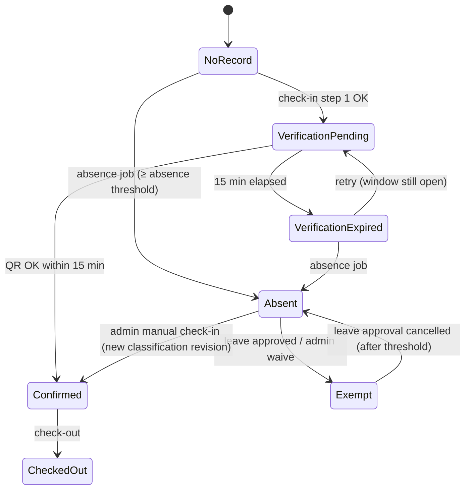
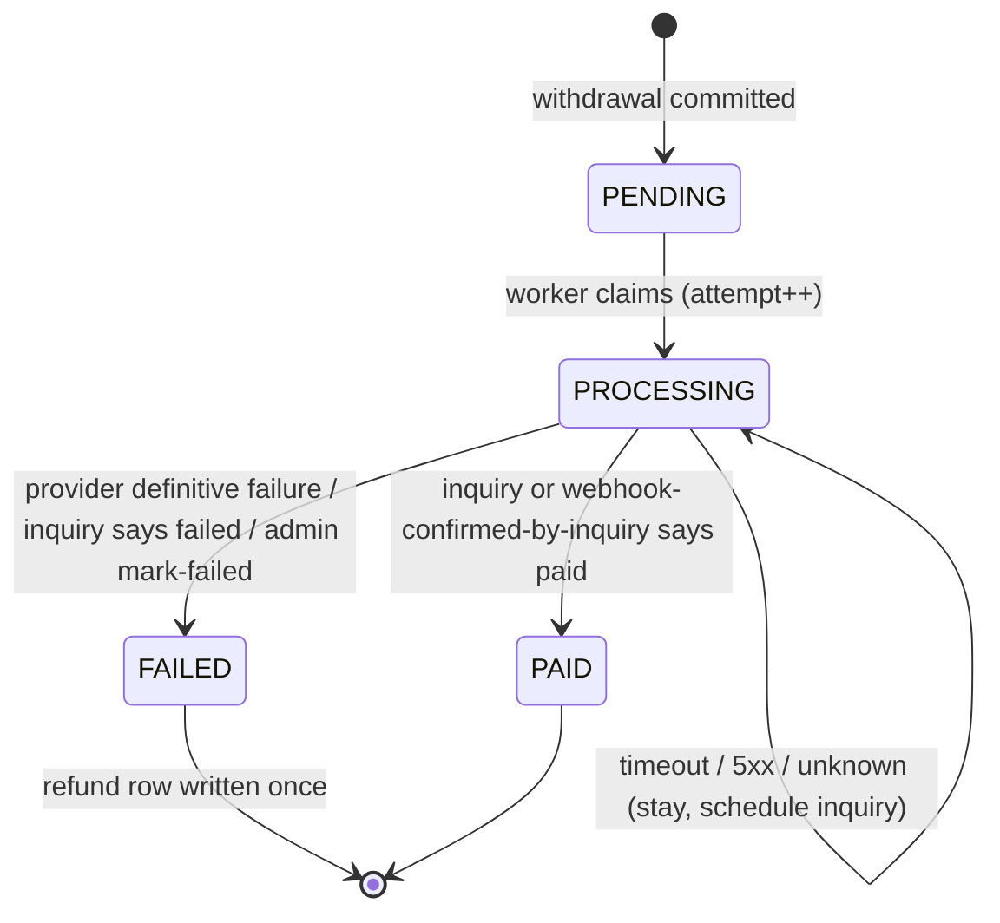

# 05 — System Design

| Field | Value |
|---|---|
| **Version** | 3.0 |
| **Status** | Final draft — implementation-ready; open items marked `DECISION NEEDED (DN-xx)` (register in `02-PRD.md` §9) |
| **Last Updated** | 2026-10-08 |
| **Source of Truth** | The finalization prompt ("SoT") overrides older documents. This document contains **no application code**; algorithms are given as numbered steps. |

---

## 1. Conventions

| Topic | Rule |
|---|---|
| Base path | `/api/v1`; Swagger UI at `/api/docs` |
| Format | JSON; dates `YYYY-MM-DD` (Cairo calendar date); months `YYYY-MM`; instants ISO-8601 UTC |
| Pagination | `page` + `pageSize` (offset). Cursor pagination is not used (SoT §24). |
| Errors | `{ "code": "…", "message": "…", "details": {…}, "requestId": "…" }` |
| Idempotency | Header `Idempotency-Key` required on: `POST /me/fund/withdrawals`, `POST /admin/fund/adjustments`, `POST /admin/points`. Same key + same payload ⇒ original result; same key + different payload ⇒ `422 IDEMPOTENCY_KEY_REUSED`. |
| Time | Server time only. Business clock = injectable `Clock` returning an instant; business calendar = `Africa/Cairo`. Clients never send timestamps for check-in/out. |
| Money | `NUMERIC`; Decimal arithmetic; round half-up to 2 decimals **once per computed line** (§9). |
| Audit | Every admin mutation writes `audit_logs` **in the same DB transaction**. |

Common error codes: `UNAUTHENTICATED`, `FORBIDDEN`, `VALIDATION_FAILED`, `NOT_FOUND`, `CHECKIN_NOT_OPEN`, `ATTENDANCE_CLOSED`, `NOT_A_WORKING_DAY`, `LEAVE_APPROVED`, `ALREADY_CHECKED_IN`, `ALREADY_CHECKED_OUT`, `OUTSIDE_GEOFENCE`, `GPS_ACCURACY_TOO_LOW`, `QR_TOKEN_INVALID`, `QR_LOCATION_MISMATCH`, `VERIFICATION_EXPIRED`, `MONTH_LOCKED`, `INSUFFICIENT_FUND`, `PAYOUT_METHOD_REQUIRED`, `PAYOUT_METHOD_COOLDOWN`, `LIMIT_EXCEEDED`, `IDEMPOTENCY_KEY_REUSED`, `INVALID_STATE`, `USE_ATTENDANCE_CORRECTION`.

## 2. API Design

### 2.1 Auth (public / any authenticated)
| Method & path | Purpose |
|---|---|
| `POST /auth/login` | email + password → access + refresh |
| `POST /auth/refresh` | rotate refresh token |
| `POST /auth/logout` | revoke refresh family |
| `PATCH /me/password` | change own password |
| `GET /me` | profile, role, today's schedule summary |

### 2.2 Employee (`EMPLOYEE`; own data only)
| Method & path | Purpose |
|---|---|
| `POST /attendance/check-in` `{lat,lng,accuracy}` | Step 1: GPS+geofence+accuracy ⇒ `PENDING` verification `{verificationId, locationId, expiresAt}` |
| `POST /attendance/check-in/{verificationId}/confirm` `{qrToken}` | Step 2: QR ⇒ attendance `CONFIRMED` + point |
| `POST /attendance/check-out` `{lat,lng,accuracy}` | Check-out + overtime Greens |
| `GET /me/attendance?month=` | Attendance history |
| `GET /me/points?month=&type=&page=` | Ledger entries with derived state (active / cancelled-by / reversed / consumed / settled) |
| `GET /me/points/summary?month=` | Counts by type and state |
| `GET /me/payroll-estimate?month=` | Monetary impact (same calculator as Month Close, flagged `estimate`) |
| `POST /leaves` `{type,from,to,reason}` · `GET /leaves/mine` · `POST /leaves/{id}/cancel` | Leave |
| `POST /early-leaves` `{date,requestedCheckoutTime,reason}` · `GET /early-leaves/mine` · `POST /early-leaves/{id}/cancel` | Early leave |
| `GET /me/fund` · `GET /me/fund/transactions` | Balance (derived) and ledger |
| `PUT /me/payout-method` `{type,issuer,account,holderName}` | Creates a new immutable method row, deactivates the old one |
| `POST /me/fund/withdrawals` `{amountUsd}` + `Idempotency-Key` | Withdrawal (returns payout `PENDING`, HTTP 202) |
| `GET /me/payouts` | Payout history/status |
| `GET /me/notifications` · `PATCH /me/notifications/{id}/read` | In-app notifications |

### 2.3 Admin (`ADMIN`)
| Group | Endpoints |
|---|---|
| Employees | `GET/POST /admin/users` · `GET/PATCH /admin/users/{id}` · `POST /admin/users/{id}/{disable, reactivate, reset-password}` · `PUT /admin/users/{id}/locations` · `POST /admin/users/{id}/salaries` |
| Schedules | CRUD `/admin/schedules` · `POST /admin/schedule-assignments` · `PATCH /admin/schedule-assignments/{id}` (future only) |
| Locations | CRUD `/admin/locations` · `GET /admin/locations/{id}/qr-token` (current rotating token + `expiresAt`) |
| Calendar | CRUD `/admin/holidays` · `GET/PUT /admin/settings/weekly_off_days` · `POST /admin/off-day-work` · `DELETE /admin/off-day-work/{id}` |
| Attendance | `GET /admin/attendance?userId=&from=&to=` · `POST /admin/attendance/manual-check-in` · `POST /admin/attendance/manual-check-out` · `POST /admin/attendance/{id}/correct` |
| Points | `GET /admin/points?userId=&month=` · `POST /admin/points` `{userId,type,quantity,workDate,reason}` · `POST /admin/points/{id}/reverse` `{reason}` · `GET/POST /admin/point-values` |
| Leave | `GET /admin/leaves?status=` · `POST /admin/leaves/{id}/{approve, reject, cancel-approval}` `{note}` |
| Early leave | `GET /admin/early-leaves?status=` · `POST /admin/early-leaves/{id}/{approve, reject}` `{note}` |
| Payroll | `GET /admin/payroll/months/{month}/preview` · `POST /admin/payroll/months/{month}/close` `{usdEgpRate}` · `GET /admin/payroll/months/{month}/records` · `POST /admin/payroll/adjustments` |
| Fund | `GET /admin/fund/users/{id}` · `POST /admin/fund/adjustments` `{userId,amountUsd,reason}` + `Idempotency-Key` |
| Payouts | `GET /admin/payouts?status=&userId=` · `POST /admin/payouts/{id}/inquire` · `POST /admin/payouts/{id}/resend` · `POST /admin/payouts/{id}/mark-paid` · `POST /admin/payouts/{id}/mark-failed` |
| Settings / Audit | `GET/PATCH /admin/settings` · `GET /admin/audit-logs?entity=&actor=&from=&to=` |

### 2.4 Webhooks
| Path | Purpose |
|---|---|
| `POST /webhooks/paymob` | Signed provider callback (raw body signature check, no JWT). Hint only. |

## 3. Authentication

1. **Login** — normalize email; check throttle (Redis counter `email+IP`, e.g., 5 failures/15 min ⇒ `429`); load active user; argon2id verify; issue access JWT (15 min; claims `sub`, `role`) and a refresh token (random 256-bit; **SHA-256 hash** stored in `refresh_tokens` with `family_id`, `expires_at` e.g. 30 days).
2. **Refresh** — look up hash; if valid & unrevoked: revoke it (`replaced_by`), issue new pair in the same family. If an **already-rotated** token is presented ⇒ revoke the whole family (theft signal) and return `401`. Re-check `users.active`.
3. **Logout** — revoke the family.
4. **Disable user** — revoke all families in the disabling transaction.
5. **Password hashing** — argon2id with parameters from config; passwords never logged.
6. **RBAC foundation** — `PermissionGuard` resolves `role → permissions` (cached in process memory, invalidated on role change). Permission names: `resource.action.scope` (e.g., `attendance.read.own`, `attendance.read.any`, `points.reverse.any`, `payroll.close.any`). Only `ADMIN` and `EMPLOYEE` rows are seeded (see `04-ARCHITECTURE.md` §11).

## 4. Attendance

### 4.1 Effective schedule and windows
- `ScheduleResolver.forDate(userId, date)` returns the `schedule_assignments` row covering `date` (`effective_from ≤ date ≤ effective_to or null`). None ⇒ employee is **not scheduled**: no check-in, no Black.
- Window instants (all computed in Cairo local time, then stored as UTC):

```text
start         = date + work_start
early_end     = start + early_minutes           (default +60)
normal_end    = early_end + normal_minutes      (default +60)
late_end      = normal_end + late_minutes       (default +120)   ← absence threshold (12:00)
shift_end     = date + work_end
```

- `classifyCheckIn(t)` (pure): `t < start` → `NOT_OPEN`; `[start, early_end)` → `EARLY/GREEN`; `[early_end, normal_end)` → `NORMAL/WHITE`; `[normal_end, late_end)` → `LATE/RED`; `t ≥ late_end` → `CLOSED`.

### 4.2 Check-in — step 1 (GPS + geofence)
1. Authenticated employee; compute `now` and `work_date` (Cairo).
2. If an `attendance` row exists for the date: `CONFIRMED` ⇒ `409 ALREADY_CHECKED_IN`; `ABSENT`/`EXEMPT` ⇒ `422 ATTENDANCE_CLOSED`/`LEAVE_APPROVED`.
3. If a `PENDING` verification exists with `expires_at > now` ⇒ return it (idempotent `200`).
4. Date must be attendance-expected: working day (or active off-day-work exception, DN-12); no `APPROVED` leave covering the date (`LEAVE_APPROVED`); effective schedule exists.
5. `classifyCheckIn(now)`: `NOT_OPEN` ⇒ `CHECKIN_NOT_OPEN` (DN-04); `CLOSED` ⇒ `ATTENDANCE_CLOSED`.
6. `accuracy ≤ settings.gps_max_accuracy_m` (DN-14) else `GPS_ACCURACY_TOO_LOW`.
7. Haversine distance to each assigned location; choose the nearest location whose `radius_m` contains the point; none ⇒ `OUTSIDE_GEOFENCE`.
8. Insert `attendance_verifications` (`PENDING`, `started_at = now`, `expires_at = now + 15 min`, location, coordinates). The partial unique index "one `PENDING` per user+date" resolves concurrent attempts (loser re-reads and returns the winner's row).
9. Nothing is awarded; **GPS alone never confirms attendance.**

### 4.3 Check-in — step 2 (QR confirmation)
1. Load verification (must belong to caller). `CONFIRMED` ⇒ `409`; `EXPIRED` or `expires_at ≤ now` ⇒ `410 VERIFICATION_EXPIRED` (row marked `EXPIRED` by the sweeper, or lazily).
2. Validate `qrToken` (§4.5). Location must equal `verification.location_id` else `QR_LOCATION_MISMATCH`.
3. **Transaction** (user lock): re-check no attendance row; classify using `verification.started_at`; insert `attendance` (`CONFIRMED`, `check_in_at = started_at`, `confirmed_at = now`, `schedule_snapshot`, classification, `classification_rev = 1`); mark verification `CONFIRMED`; award the point (§5.1, `source = ATTENDANCE`, `dedupe_key = ATT:{userId}:{date}:1`); run offset engine; audit not required (employee action) but the point row is its own history; create notification if RED.
4. Commit.

### 4.4 Check-out
1. Authenticated; attendance for today must be `CONFIRMED` with `check_out_at IS NULL` (else `409 ALREADY_CHECKED_OUT` / `422 INVALID_STATE`).
2. GPS accuracy + geofence (any assigned location). QR at checkout: DN-07 (MVP: not required).
3. `minutes_after_end = max(0, floor((now − shift_end) / 60 s))`; `units = floor(minutes_after_end / overtime_unit_minutes)`; apply daily cap if configured (DN-07).
4. If an `APPROVED` early-leave exists for the date ⇒ `units = 0`.
5. **Transaction** (user lock): set `check_out_at`; if `now < shift_end` and no approved early leave ⇒ `left_early = true` (DN-08, no penalty); for `i = 1..units` insert Green (`source = OVERTIME`, `dedupe_key = OT:{attendanceId}:{i}`); store `overtime_greens = units`; run offset engine.
6. Examples: 16:59 → 0; 17:01 → 1; 18:01 → 2; 19:01 → 3.

### 4.5 QR token
- Per location secret `qr_secret` (random, never returned by API).
- `slot = floor(unix_seconds / qr_rotation_seconds)` (default 30).
- Token = `v1.{locationId}.{slot}.{base64url(HMAC-SHA256(qr_secret, locationId|slot))}`.
- Validation: signature matches (constant-time), `slot ∈ {currentSlot, currentSlot−1}` (≈ ≤ 60 s), location exists.
- `GET /admin/locations/{id}/qr-token` returns the current token and `validUntil`; the kiosk page polls it.
- No static/permanent QR; tokens are not stored. Replay is bounded by slot age and by the requirement of a live, single-use verification bound to the same employee and location.

### 4.6 Attendance state



`attendance.status ∈ {CONFIRMED, ABSENT, EXEMPT}`; check-out is `check_out_at IS NOT NULL`. Verification state is separate (`PENDING/CONFIRMED/EXPIRED`).

### 4.7 Admin corrections
`POST /admin/attendance/manual-check-in` (create `CONFIRMED` row, `source = ADMIN`), `manual-check-out`, and `POST /admin/attendance/{id}/correct` with `action ∈ {SET_CHECK_IN, SET_CHECK_OUT, EXEMPT}` + mandatory `reason`.
**Transaction** (user lock, month open): reverse the current ATTENDANCE point (`reason_code = ATTENDANCE_CORRECTION`) and/or surplus OVERTIME points; recompute classification (same windows; ≥ absence threshold ⇒ BLACK) and overtime units; award the new point with `classification_rev + 1` (`EXEMPT` ⇒ no new point, status `EXEMPT`); undo affected offsets; run engine; write audit (before/after).
`ATTENDANCE`/`OVERTIME` points are changed **only** through corrections (or leave approval); `POST /admin/points/{id}/reverse` on them ⇒ `USE_ATTENDANCE_CORRECTION`.

## 5. Points

### 5.1 Award
All awards go through `PointsService.award(tx, {userId, workDate, type, source, reason, actor, dedupeKey, attendanceId?})`:
1. Precondition: caller holds the user lock.
2. Reject if `payroll_month(workDate)` is locked (`MONTH_LOCKED`).
3. Insert one `point_transactions` row (`entry_kind = AWARD`, `delta = +1`). `dedupe_key` unique ⇒ a retry becomes a no-op (caught and treated as already done).
4. Caller then invokes `OffsetEngine.run`.

Admin add (`quantity n`, `n ≤ admin_point_max_quantity`, DN-18) inserts `n` rows with `dedupe_key = ADM:{idempotencyKey}:{i}`. Admin adding GREEN follows the normal Green lifecycle; WHITE never takes part in offsets.

### 5.2 Derived point state (no updates, ever)
A **view** `point_state` derives status from immutable rows:

| Point type | State | Definition |
|---|---|---|
| any AWARD | `REVERSED` | a reversal row exists with `reverses_id = id` |
| GREEN | `CONSUMED` | an active offset (APPLY without UNDO) uses it as `source_point_id` |
| GREEN | `SETTLED_TO_FUND` | not reversed, not consumed, `payroll_month` locked |
| GREEN | `AVAILABLE` | otherwise |
| RED / BLACK | `CANCELLED` | an active offset targets it |
| RED / BLACK | `ACTIVE` | not reversed, not cancelled |
| WHITE | `RECORDED` | informational only |

### 5.3 Offset engine (`OffsetEngine.run(tx, userId)`) — event-driven
Precondition: user lock held. Open months = months without a `LOCKED` row in `payroll_months`.
1. Load `AVAILABLE` Greens, `ACTIVE` Reds and `ACTIVE` Blacks whose `payroll_month` is open; order each by `(work_date, created_at, id)` ascending (oldest first).
2. **Red pass:** while a Red and a Green both remain: take the oldest Red and oldest Green; insert one `point_offsets` APPLY row (`target = Red`, `source = Green`, new `group_id`).
3. **Black pass:** while a Black remains and ≥ 5 Greens remain (`offset_greens_per_black`): take the oldest Black and the 5 oldest Greens; insert 5 APPLY rows sharing one `group_id` — **all in the same transaction; never partial**.
4. Return the list of created offsets (for notifications).
- Idempotent: running again with no new points changes nothing.
- **Runs after:** attendance confirm, overtime award, admin add, any reversal, offset undo, leave-approval reversal, attendance correction, and once per user inside Month Close.
- **Undo:** when a point that participates in an active offset is reversed, insert UNDO rows for **every** APPLY row of that `group_id` (`reverses_offset_id` unique), then run the engine again so freed Greens/targets are re-matched.
- Offsets never touch a point whose month is locked; a DB trigger enforces it.
- **Path dependence (by design):** the engine is eager, so when Greens are scarce the outcome depends on chronological arrival (see Golden Case G4). The rule "Reds before Blacks, oldest first" is applied at each run (DN-09).

### 5.4 Reverse / void
`POST /admin/points/{id}/reverse {reason}`; **transaction** (user lock):
1. Target must exist, be `ADMIN`-source (see §4.7), not a reversal row, not already reversed (unique `reverses_id` ⇒ at most once), and its month must be open.
2. Insert reversal row (`entry_kind = REVERSAL`, `delta = −1`, same type, `reverses_id`, `actor_id`, `reason`, `reason_code = ADMIN_REVERSE|ADMIN_VOID`).
3. Undo any active offset group involving the target; run engine.
4. Audit before/after; notify employee.
A reversal cannot be reversed; to restore, admin adds a new point citing the original.

### 5.5 Admin adjustment
Admin may add any of GREEN/WHITE/RED/BLACK (reason mandatory) or reverse an `ADMIN`-source point. "Change quantity" = reverse + add. Adjustments in locked months are refused; use payroll/fund adjustments instead.

## 6. Leave

- **Create** (`POST /leaves`): `type ∈ {ANNUAL, SICK, UNPAID}`, `from ≤ to`; no overlap with another `PENDING`/`APPROVED` request of the employee; dates may be in the past if their month is open. Status `PENDING`; notify admins (in-app).
- **Approve** (**transaction**, user lock): covered dates = working days in range. Refuse if any covered date has a `CONFIRMED` attendance, or lies in a locked month. For each covered date with `ABSENT` attendance: reverse the Black (`LEAVE_APPROVED`), set attendance `EXEMPT`, undo affected offsets. Set request `APPROVED` (`reviewed_by`, `reviewed_at`). Run engine. Audit. Notify.
- **Reject:** `PENDING → REJECTED`; no point change.
- **Cancel approval:** `APPROVED → CANCELLED` (admin); for covered dates whose absence threshold has passed with no attendance: set attendance back to `ABSENT` and award a Black (new revision) in the same transaction; run engine; audit.
- **Employee cancel:** only own `PENDING`.
- State machine: `PENDING → APPROVED | REJECTED | CANCELLED`; `APPROVED → CANCELLED`.
- Salary treatment: from `leave_pay_policy` at payroll time (DN-02); nothing hardcoded.

## 7. Early Leave

- **Request:** `POST /early-leaves {date, requestedCheckoutTime, reason}`; date ≥ today (Cairo); `requestedCheckoutTime` between `work_start` and `work_end`; partial unique index: one `PENDING`/`APPROVED` per employee/date. Status `PENDING`.
- **Approve:** conditional update `WHERE status='PENDING'` (no explicit row lock needed); store `reviewed_by`, note; if an attendance row exists, set `attendance.early_leave_request_id`. Effects at check-out: record actual time, **no penalty, no overtime Green**. Audit + notify.
- **Reject:** `PENDING → REJECTED`; employee's later checkout is recorded normally; **no new point type**.
- Employee may cancel own `PENDING`.

## 8. Payroll

### 8.1 Calculator (pure function `calculatePayroll(input) → record`)
Inputs per employee and month `M`: salary version(s), working days (from calendar), approved leave days by type, point counts/values, adjustments, settings (`deduction_policy`, `leave_pay_policy`), `usd_egp_rate`.

```text
working_days        = count of days in M that are not weekly-off and not holidays
daily_rate_display  = base_salary / working_days           (display only)
leave_deduction     = ROUND( base_salary × Σ(unpaid-type approved working days) / working_days , 2 )
greens_earned       = Greens awarded in M, net of reversals
greens_consumed     = Greens of M used by active offsets (any target month)
greens_remaining    = greens_earned − greens_consumed        ← only these become Fund
active_reds/blacks  = points in M with state ACTIVE (after offsets)
potential_red       = Σ value(RED at work_date)    (250 EGP default)
potential_black     = Σ value(BLACK at work_date)  (1000 EGP default)
applied_red         = deduction_policy.red_enabled   ? potential_red   : 0
applied_black       = deduction_policy.black_enabled ? potential_black : 0
(cap)               = if cap_percent_of_base set: min(applied_red+applied_black, cap% × base)
adjustments         = Σ payroll_adjustments applying to M
net_payroll_egp     = base_salary − leave_deduction − applied_red − applied_black + adjustments
fund_credit_usd     = greens_remaining × value(GREEN)          (1 USD default)
fund_credit_egp_eq  = fund_credit_usd × usd_egp_rate           (information only)
```

WHITE points never enter any formula. Greens consumed by offsets are never in `greens_remaining` (no double pay). Deductions are **off by default** (DN-01).

### 8.2 Preview
`GET …/preview` runs the calculator for all employees with a salary/assignment in the month without writing anything; lists blocking issues (§8.3) and warnings (`partial_month`). The employee `payroll-estimate` calls the same function for one employee.

### 8.3 Month Close (`POST …/close {usdEgpRate}`)
Pre-checks (DN-17): month fully ended in Cairo; every earlier month with data is `LOCKED`; absence sweeper caught up for the last day; no `PENDING` leave/early-leave overlapping the month; `usdEgpRate > 0` (**required, no default**).
**One DB transaction:**
1. Lock the `payroll_months` row (insert `OPEN` if absent) `FOR UPDATE`; refuse if `LOCKED`.
2. Lock all affected `users` rows **in ascending id order**.
3. For each employee: run `OffsetEngine.run` (month still open).
4. Compute the record with the calculator; insert `payroll_records` (snapshot incl. counts, values, flags, JSON detail).
5. If `fund_credit_usd > 0`: insert `fund_transactions` `MONTH_CLOSE_CREDIT` (`payroll_month` unique per user).
6. Set `payroll_months`: `LOCKED`, `usd_egp_rate`, `locked_at`, `locked_by` (**last step**; from now on triggers reject writes for the month).
7. Audit; notifications to employees inserted.
Commit. Failure at any step rolls back everything; rerun is safe.

### 8.4 Lock and adjustments
- Locked month: no point, offset, record or payroll-adjustment writes (service check + trigger).
- `POST /admin/payroll/adjustments {userId, appliesToMonth, amountEgp(+/−), reason}`: allowed only for an **open** month; append-only. Fixes to a locked month are entered as an adjustment in the next open month, with `corrects_month` referencing it.
- Salary-change/join proration: DN-11 (provisional flags, see PRD §6.9).

## 9. Money Rules
- DB types: `NUMERIC(14,2)` amounts; `NUMERIC(12,6)` FX rate.
- Point money values are integers × config (250, 1000, 1) ⇒ exact. The only division is leave deduction, rounded **once** half-up to 2 decimals.
- Fund is held in **USD** (SoT: 1 Green = 1 USD). EGP equivalents use the rate frozen at Month Close for display; payout conversion rate: DN-03.
- Never read money from Redis or from the client.

## 10. Fund

- **Credit:** only by Month Close (`MONTH_CLOSE_CREDIT`), refunds (`WITHDRAWAL_REFUND`), admin `ADJUSTMENT`.
- **Balance:** `SELECT COALESCE(SUM(amount),0) FROM fund_transactions WHERE user_id = $1`. No cached balance.
- **Withdrawal** — single DB transaction:
  1. Lock user row (`FOR UPDATE`).
  2. Idempotency: look up `payouts(user_id, idempotency_key)`; found ⇒ return it (payload must match).
  3. Validate: employee active (DN-13), active payout method and cooldown elapsed, `amount ≥ min`, daily/monthly caps (sums of non-failed payouts), `balance ≥ amount` else `INSUFFICIENT_FUND`.
  4. Insert `payouts` (`PENDING`, generated unique `client_reference`, FX snapshot, method id).
  5. Insert `fund_transactions` (`WITHDRAWAL`, `−amount`, `payout_id`).
  6. Insert `outbox_events` (`PAYOUT_SEND`, payout id).
  7. Commit → return `202` with payout.
- **Admin adjustment:** user lock; a negative adjustment may not make the balance negative; reason mandatory; idempotency key; audited.

## 11. Payments (Paymob)

### 11.1 Payout state machine

A timeout is **never** a transition to `FAILED`.

### 11.2 Send (worker, `payout.send`)
1. **Tx A:** lock payout `FOR UPDATE`; if `PENDING` ⇒ `PROCESSING`, `attempts++`, `last_attempt_at`; if already `PROCESSING` ⇒ skip to inquiry. Commit.
2. Outside any transaction: get Paymob token (Redis cache, refresh < 60 min), call `send(client_reference, amount_egp, method)`.
3. Result handling:
   - *Accepted* ⇒ store `provider_reference` (short tx), stay `PROCESSING`, enqueue `inquire`.
   - *Definitive reject* (validation/insufficient merchant balance/invalid account) ⇒ **Tx B:** payout `FAILED` + `failure_reason` + `WITHDRAWAL_REFUND` row.
   - *Timeout / network / 5xx / unparseable* ⇒ stay `PROCESSING`; enqueue `inquire` (delayed).
4. Handler is idempotent: BullMQ `jobId = payoutId:send:n`; state guards in Tx A/B.

### 11.3 Inquiry (`payout.inquire`)
Calls `inquire(client_reference)` outside any transaction; then, in a short transaction with payout row lock:
- `PAID` ⇒ `PAID`, `processed_at`.
- `FAILED` ⇒ `FAILED` + refund row (unique per payout, so exactly once).
- `PENDING_AT_PROVIDER` ⇒ reschedule (backoff 1 m, 5 m, 15 m, 1 h, 6 h, then every 6 h; bank rails can take ~2 working days).
- `NOT_FOUND` after the send window ⇒ safe re-send with the **same** `client_reference` (max attempts configurable); beyond max ⇒ `needs_attention = true` + admin alert. Provider-side idempotency guarantees: DN-15.
- `needs_attention` also set if `PROCESSING` longer than `stuck_processing_alert_hours` (default 72).

### 11.4 Webhook
1. Read **raw body**; verify provider signature (scheme per Paymob docs, confirmed in sandbox — DN-15); invalid ⇒ `401`, nothing stored as trusted.
2. Insert `payment_webhook_events` (unique provider event id/payload hash) ⇒ duplicates are ignored.
3. Respond `200` quickly; enqueue `payout.inquire` for the referenced payout. **The webhook is a hint; final state always comes from inquiry.**

### 11.5 Manual fallback
- `inquire` (force), `resend` (only when inquiry = `NOT_FOUND`), `mark-paid {providerReference, note}`, `mark-failed {note}` (writes refund). Only from `PROCESSING`; note mandatory (admin confirmed in Paymob dashboard); provider recorded as `MANUAL`; audited.
- If a late provider `PAID` arrives for a manually `FAILED`+refunded payout, the system raises a mismatch alert and does **not** auto-change state; admin resolves with a fund adjustment.

### 11.6 Payout methods
Immutable rows (`type WALLET|BANK`, issuer, `account_encrypted` AES-256-GCM, `account_last4`, `holder_name`). Changing = new row, old row `is_active=false`; `cooldown_until = now + payout_method_cooldown_hours` (DN-13). One active method per employee (MVP).

## 12. Background Jobs (only what is needed)

| Job | Schedule | Behavior |
|---|---|---|
| `attendance-sweeper` | every minute | (1) `PENDING` verifications with `expires_at ≤ now` ⇒ `EXPIRED`. (2) Absence sweep (below). |
| `outbox-relay` | every 5–10 s | `SELECT … FROM outbox_events WHERE status='PENDING' ORDER BY id FOR UPDATE SKIP LOCKED LIMIT n`; enqueue BullMQ job with `jobId = outbox id`; mark `PUBLISHED`. On enqueue failure leave `PENDING` (retry next tick). |
| `payout.send` / `payout.inquire` | on demand / delayed | §11 |
| `housekeeping` | daily | purge expired refresh tokens; alert on stuck payouts |

**Absence sweep** — for each date `d` from `max(today − absence_lookback_days, first open month start)` to `today`, and each employee eligible on `d`:
- eligible = active on `d` (`d ≥ users.active_from` and not disabled before `d`), schedule assignment covers `d`, `d` is a working day, **no** off-day-work exception handling needed (exception ⇒ no Black), no approved leave covering `d`, no `attendance` row, **no unexpired `PENDING` verification**, month of `d` open, and `now ≥ late_end(d)` (`now` past the threshold for today; always true for past days).
- Per employee, one short **transaction** with user lock: insert `attendance (ABSENT, BLACK, rev 1)` `ON CONFLICT DO NOTHING`; if inserted ⇒ award Black (`dedupe_key = ATT:{userId}:{d}:1`); run engine; notify. Rerun/parallel run ⇒ conflict ⇒ no-op.
- Month Close is **not** a scheduled job (admin-triggered).

## 13. Audit
`AuditService.record(tx, {actor, action, entity, entityId, before, after, requestId, ip})` is called inside the business transaction for **every admin mutation** and payout state event. Append-only (no UPDATE/DELETE grants + trigger).

## 14. Transaction Boundaries

Legend: **Tx** = DB transaction; **UL** = `SELECT … FOR UPDATE` on the user row (user lock); **PL** = row lock on the payout/month row. Locks are used only where a read-then-write race would corrupt points or money.

| Operation | Tx | Lock | Notes |
|---|---|---|---|
| Check-in step 1 | short Tx (or single insert) | none — partial unique index on `PENDING` | no points touched |
| Check-in confirm | Tx | **UL** | attendance + point + offsets together |
| Check-out | Tx | **UL** | overtime Greens + offsets |
| Absence sweep (per employee) | Tx | **UL** | `ON CONFLICT DO NOTHING` + unique dedupe |
| Verification expiry | single `UPDATE … WHERE status='PENDING' AND expires_at<=now` | none | idempotent |
| Admin add / reverse point | Tx | **UL** | + audit |
| Attendance correction | Tx | **UL** | reverse + re-award + offsets + audit |
| Leave approve / cancel approval | Tx | **UL** (employee) | reversals/awards + offsets |
| Early-leave approve/reject | Tx | none — conditional `UPDATE … WHERE status='PENDING'` | |
| Month Close | one Tx | **PL on `payroll_months`** + **UL on all users (ascending id)** | locks month last |
| Payroll adjustment | Tx | month check | open month only |
| Withdrawal | Tx | **UL** | ledger debit + payout + outbox |
| Admin fund adjustment | Tx | **UL** | no negative balance |
| Payout claim (Tx A) | short Tx | **PL (payout row)** | before provider call |
| Payout final state (Tx B) | short Tx | **PL (payout row)** | + refund row (unique per payout) |
| Webhook intake | single insert | none | unique event id |
| Refresh rotation | short Tx | token row `FOR UPDATE` | reuse detection |
| Settings/CRUD/reads | none or simple Tx | none | no locks "just in case" |

**External calls that MUST happen outside DB transactions:** Paymob `send`/`inquire`/token fetch, Redis/BullMQ enqueue (done by the outbox relay after commit), email/push, any HTTP call. **Lock order:** `payroll_months` → `users` ascending id → `payouts` → other rows.

**Check-in confirm (shape):**
`BEGIN → lock user → validate verification + attendance uniqueness → insert attendance → award point → run offsets → COMMIT`.
**Withdrawal (shape):**
`BEGIN → lock user → idempotency + validations + balance → insert payout → insert debit → insert outbox → COMMIT` (Paymob is called later by a worker).

## 15. Testing Strategy

### 15.1 Unit tests (pure functions, fake `Clock`)
| Area | Cases |
|---|---|
| Classification | 07:59:59 not open (DN-04) · 08:00:00 EARLY · 08:59:59 EARLY · 09:00:00 NORMAL · 09:59:59 NORMAL · 10:00:00 RED · 11:59:59 RED · 12:00:00 CLOSED · custom schedule offsets |
| Overtime | 16:00→0 · 16:59→0 · 17:00→1 (DN-06) · **17:01→1 · 18:01→2 · 19:01→3** · approved early leave→0 · cap (if set) |
| Green offset | no Reds · Greens < Reds · Greens > Reds · oldest Red first · oldest Green first |
| Red cancellation | 1:1 ratio; consumed Green not reusable |
| Black cancellation | 4 Greens ⇒ no cancel; 5 ⇒ cancel; 9 ⇒ one Black; atomic group; Reds before Blacks |
| Payroll formula | policy on/off · cap · leave types · adjustments · rounding · WHITE ignored |
| Money | no double count: `remaining = earned − consumed` |

### 15.2 Integration tests (HTTP + real PostgreSQL via Testcontainers)
Check-in (happy path both steps) · duplicate check-in · GPS outside/accuracy · **QR expiry (token and 15-min window)** · wrong-location QR · GPS-only never confirms · leave approval (Black reversal, offsets undone) · leave on confirmed day refused · early leave approve/reject · admin point add/reverse (reverse twice refused) · attendance correction · **month close** (records, fund credit, lock, trigger rejects later writes) · **withdrawal** (balance, idempotency, outbox row) · payout failure ⇒ refund once · timeout ⇒ stays `PROCESSING` ⇒ inquiry decides · webhook signature and duplicate event.

### 15.3 Concurrency tests (parallel requests against real DB)
Two simultaneous check-ins (one verification/attendance) · two simultaneous confirms (one point) · two simultaneous withdrawals (second sees reduced balance; never negative) · repeated/parallel absence sweeps (one Black) · double point reversal (one reversal row) · simultaneous admin reverse + offset engine run · duplicate outbox relay (single job per `jobId`).

### 15.4 Golden cases
Assumptions: Greens ≥ penalties at each engine run unless stated; Red = 250 EGP, Black = 1000 EGP, Green = 1 USD; **no exchange rate assumed** (EGP equivalent = USD × frozen rate `R`). "Policy ON" = both deductions enabled, no cap.

**G1 — SoT example (order-insensitive because Greens suffice).** 30 working days: 20 Early, 5 Normal, 3 Late, 2 Absent, 10 overtime Greens.

| Item | Value |
|---|---|
| Gross earned points | Green 20 + 10 = **30**, White **5**, Red **3**, Black **2** |
| Red pass | 3 Greens cancel 3 Reds (oldest first) → Greens left 27 |
| Black pass | 2 × 5 = 10 Greens cancel 2 Blacks → Greens left **17** |
| Consumed Greens | 3 + 10 = **13** |
| Remaining Greens | **17** → Fund credit **17 USD** (≈ 17·R EGP, display only) |
| Active Reds / Blacks | 0 / 0 → potential deductions **0** |
| Would-have-been potential (no offsets) | 3×250 + 2×1000 = 2,750 EGP |
| Net payroll (base **B**) | **B** (policy ON or OFF) |

**G2 — Scarce Greens.** 22 working days: 2 Early (days 1–2), 14 Normal, 4 Late, 2 Absent (later days).
Greens 2 → cancel 2 oldest Reds; Greens left 0; Blacks need 5 ⇒ none cancelled.
Consumed **2**, remaining **0** → Fund **0**. Active Reds **2** (500 EGP), Blacks **2** (2,000 EGP) → potential **2,500 EGP**.
Net with B = 20,000: policy OFF → **20,000**; policy ON → **17,500**.

**G3 — SoT §10 example.** 22 working days: 10 Early, 10 Normal, 2 Late. Greens 10, Reds 2 → 2 consumed, **8 remain → Fund 8 USD (not 10)**. Potential 0. Net = B.

**G4 — Eager path dependence (documented behavior).** Five Early days (5 Greens).
- *Order A:* Absent (Black) next, then Late (Red): the Black is cancelled with 5 Greens (Greens 0); the later Red stays ACTIVE → potential **250 EGP**.
- *Order B:* Late (Red) first: 1 Green cancels it (4 left); a later Absent (Black) cannot be cancelled (needs 5) → potential **1,000 EGP**.
Outcome follows chronological order; tests lock this behavior (DN-09).

**G5 — Red-then-Black boundary.** 7 Greens, 1 Red, 1 Black (any order): Red uses 1 Green; Black uses 5; **1 Green remains → Fund 1 USD**; potential 0.

**G6 — Unpaid leave.** Base 22,000 EGP, 22 working days, 2 `UNPAID` approved leave days, 20 Normal days (20 White): leave deduction = 22,000 × 2 / 22 = **2,000**; no Red/Black/Green; Fund 0; Net (UNPAID deducts) **20,000**; with `UNPAID` marked paid in policy → 22,000.

**G7 — Admin reversal.** G1 plus admin reverses one Early Green that was consumed by a Black group: the group is undone (5 Greens freed), engine re-runs and re-matches; totals recomputed deterministically; reversal row and UNDO rows exist; nothing deleted.

## 16. Invariant Enforcement Map
Defined in `08-DATABASE_SCHEMA.md` §4; each is enforced by a DB constraint/trigger **and** covered by a test above.
