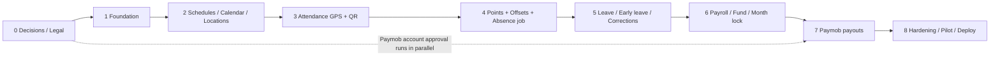

# 06 — Roadmap

| Field | Value |
|---|---|
| **Version** | 3.0 |
| **Status** | Final draft — implementation-ready |
| **Last Updated** | 2026-10-08 |
| **Source of Truth** | The finalization prompt ("SoT") overrides older documents. Phase order follows SoT §33, with one dependency clarification (Phase 3 ↔ Phase 4, below). |

A phase is **complete only when every Definition of Done (DoD) item is checked by a passing test or a signed artifact.**

**Dependency clarification (Phase 3 → 4).** Check-in confirmation must award a point, but the points module is built in Phase 4. Phase 3 therefore defines a `PointsPort` (interface: `award`, `reverse`) with an in-memory recording implementation; attendance classification, uniqueness and overtime **units** are fully built and tested in Phase 3. Phase 4 replaces the stub with the real ledger and re-runs the Phase 3 tests against it. Nothing is released to users between these phases.

---

## Traceability: phases → planning tasks and requirements

Planning IDs come from the local `planning/` workspace (spec v0.3.0, `TASKS.json`). Business changes start there first; this roadmap stays the execution plan.

| Phase | Planning tasks | Spec requirements |
|---|---|---|
| 0 Decisions | (none; resolves DN-xx / GAP-xxx) | REQ-020 legal gate (DN-01), open DNs |
| 1 Foundation | TASK-001, 002, 003, 004, 025, 028, 030, 031, 032, 040, 042, 043, 044, 045 | REQ-001–003, REQ-006–008, REQ-028, REQ-NFR-003, REQ-NFR-004, REQ-031–033, REQ-NFR-009 |
| 2 Schedules / calendar / locations | TASK-005, 006 | REQ-009, REQ-010 |
| 3 Attendance / GPS / QR | TASK-007, 008, 009, 010, 023 (attendance part) | REQ-011–015, REQ-030 (GREEN) |
| 4 Points / offsets | TASK-012, 013, 014, 016 | REQ-017–019, REQ-029 |
| 5 Leave / early leave / corrections | TASK-011, 017, 018, 024 | REQ-016, REQ-021, REQ-022, REQ-027 |
| 6 Payroll / fund / lock | TASK-015, 019, 020, 021, 023 (pay part) | REQ-020, REQ-023–025, REQ-030 (pay) |
| 7 Paymob | TASK-022, 029 | REQ-005, REQ-026 |
| 8 Hardening / pilot | TASK-033–039 | REQ-NFR-001, 002, 005–007 |
| All phases (UI per feature) | TASK-026 (employee), TASK-027 (admin) | REQ-001, REQ-002 |

Each step's tests should name the planning `TEST-xxx` / `AC-REQ-xxx` they prove (see `09-DECISION_LOG.md` §6 for REQ → FR).

## Phase 0 — Business Decisions / Legal / Multi-Client Setup

**Goal:** Resolve every `DECISION NEEDED` that blocks money behavior, lock client framework choices, and start long-lead external approvals.

**Tasks**
- Walk through the DN register (`02-PRD.md` §9); record each answer (owner, date) in a decision log.
- Lock DN-16: Employee client = React Native (Expo) mobile app; Admin & Kiosk client = Next.js web application.
- Labor-law review of Red/Black deductions, caps, and leave pay treatment (DN-01, DN-02).
- Confirm Green bonus delivery (Fund), fund currency and payout FX source (DN-03).
- Confirm overtime boundary/cap/QR at checkout, accuracy threshold, off-day-work behavior (DN-04…DN-14).
- Apply for Paymob payouts account (sandbox + production); learn fees, limits, idempotency and webhook signature (DN-15).
- Structure workspace for multi-client development (e.g. `apps/api`, `apps/web`, `apps/mobile`) and choose hosting/backup approach (DN-19).
- Collect seed data: employees, salaries, locations (coordinates, radius), weekly off days, holidays.

**Dependencies:** none.

**Tests:** n/a (decision phase).

**Definition of Done**
- [ ] Every DN item is marked *decided* or *explicitly deferred with the provisional default accepted in writing*.
- [ ] Written legal opinion (or written decision to keep deductions disabled at launch).
- [ ] Paymob sandbox credentials obtained and application for production submitted.
- [ ] Seed data file reviewed by the admin.

---

## Phase 1 — Foundation (Backend API + Web Shell + Mobile Auth)

**Goal:** Running NestJS monolith with secure auth, RBAC foundation, audit, settings, and initial Next.js/React Native auth integration.

**Tasks**
- **[BE]**: Repo, Docker Compose (api, PostgreSQL, Redis), CI (lint, unit, integration, migration check), config validation, Pino logging, request ID, health endpoints, Swagger, `/api/v1` prefix.
- **[BE]**: Prisma + migrations; `companies` (one row), `roles`, `permissions`, `role_permissions`, `user_roles`, `users`, `employees`, `employee_compensation_versions`, `refresh_tokens`, `settings`, `audit_events`, `notifications`, `outbox_events` tables.
- **[BE]**: Auth: login, refresh rotation + reuse detection, logout, password change, admin reset, throttling.
- **[BE]**: `PermissionGuard` + seeds for `ADMIN`, `EMPLOYEE`.
- **[BE]**: Users CRUD, disable/reactivate, salary versions (1st-of-month rule).
- **[BE]**: `AuditService`, `SettingsService`, injectable `Clock`, Decimal helpers, BullMQ wiring.
- **[WEB]**: Next.js shell setup, Tailwind CSS, admin login page, cookie sign-in (`X-Auth-Mode: cookie`: HttpOnly cookies, `X-CSRF-Token` on writes, refresh through the cookie; docs/05 §3a), admin navigation layout, user profile.
- **[MOB]**: React Native (Expo) shell, employee login screen, bearer sign-in with tokens kept in `expo-secure-store` (no cookie header), refresh interceptor, session guard.

**Dependencies:** Phase 0 decisions for hosting and client stacks.

**Tests**
- Unit: permission resolution; password hashing config.
- Integration: login success/failure/throttle; refresh rotation; reuse of old token revokes family; disabled user cannot refresh; employee cannot call `/admin/*` (403); audit row written for each admin mutation.
- Client tests: Next.js admin and React Native mobile successfully authenticate and refresh tokens against NestJS API.

**Definition of Done**
- [ ] All Phase 1 integration tests pass in CI against Testcontainers PostgreSQL.
- [ ] A forced failure inside an admin mutation leaves **no** audit row and no data (same-transaction proof test).
- [ ] Swagger lists all Phase 1 endpoints; only roles `ADMIN`/`EMPLOYEE` exist in `roles`.
- [ ] `docker compose up` yields healthy `/health/ready`.
- [ ] Both Next.js web and React Native mobile clients can log in, hold secure sessions, and log out cleanly.

---

## Phase 2 — Schedules + Calendar + Locations

**Goal:** Everything needed to decide, for any employee and date, *where*, *when* and *whether* attendance is expected, plus admin management and branch kiosk UI.

**Tasks**
- **[BE]**: `shifts`, `shift_versions`, `shift_assignments` (no overlaps, future-only changes), default 08:00–16:00 (early 60 / grace 120 / red period 240).
- **[BE]**: `holidays`, weekly-off-days setting, `work_offers` (off-day-work exceptions); `isWorkingDay` / `isAttendanceExpected` services.
- **[BE]**: `locations`, `user_locations`; QR secret generation; token generate/validate functions; `GET …/qr-token`.
- **[BE]**: Pure `classifyCheckIn`, window computation with Luxon (Cairo/UTC).
- **[WEB]**: Admin CRUD for locations (geofence coordinates and radius) and schedule assignments; `/kiosk` full-screen rotating HMAC QR display.
- **[MOB]**: Mobile permission onboarding flow for Location (foreground GPS) and Camera; location status indicator.

**Dependencies:** Phase 1.

**Tests**
- Unit: classification table (`05-SYSTEM_DESIGN.md` §15.1), window computation including DST dates, `isWorkingDay`, QR token validity (current, previous slot, older slot, wrong location, tampered signature).
- Integration: overlapping assignments rejected by DB; past assignment edit rejected; geofence assignment many-to-many.

**Definition of Done**
- [ ] Classification unit tests cover every boundary second listed in `05-SYSTEM_DESIGN.md` §15.1.
- [ ] Overlapping schedule assignments fail at the database level.
- [ ] QR tokens: current/previous slot accepted, older rejected, tampered rejected (tests).
- [ ] Next.js `/kiosk` displays the rotating QR and updates every 30 seconds smoothly.
- [ ] No timezone dependence: tests pass with server `TZ` set to `UTC` and to `Pacific/Auckland`.

---

## Phase 3 — Attendance + GPS + QR (Mobile Check-in/out)

**Goal:** Two-step check-in and check-out with attendance integrity; points via `PointsPort`; native mobile camera & GPS execution.

**Tasks**
- **[BE]**: `attendance`, `attendance_verifications` tables with partial unique index (one `PENDING`), unique `(user_id, work_date)`.
- **[BE]**: Check-in step 1 (GPS accuracy, Haversine, geofence), step 2 (QR confirm), check-out (+ overtime unit calculation), history endpoints.
- **[BE]**: Verification expiry job (the first half of `attendance-sweeper`).
- **[BE]**: `PointsPort` stub recording awards.
- **[WEB]**: Admin live attendance feed; branch kiosk scan verification animation.
- **[MOB]**: Employee Home screen: Today status card, Step 1 GPS check-in button (validating accuracy against threshold), Step 2 live camera QR code scanner (with 15-min countdown timer), Check-out button.

**Dependencies:** Phase 2.

**Tests**
- Integration: happy path (08:30 → GREEN request recorded after QR); GPS-only never creates attendance; outside geofence; low accuracy; QR expired/invalid/wrong location; 15-minute expiry; duplicate check-in; duplicate checkout; off-day without exception; leave-blocked not yet (Phase 5).
- Concurrency: two simultaneous check-ins ⇒ one verification/attendance.
- Unit: overtime units 16:59→0, 17:01→1, 18:01→2, 19:01→3.

**Definition of Done**
- [ ] All tests above pass.
- [ ] A verification confirmed at `started_at + 15 min + 1 s` is rejected with `VERIFICATION_EXPIRED` (fake clock test).
- [ ] No attendance row exists after step 1 alone (assertion in test).
- [ ] Real React Native mobile app successfully scans Next.js kiosk screen and completes check-in.

---

## Phase 4 — Points + Offset Engine

**Goal:** Real append-only point ledger, offset engine, absence job, admin point operations, and mobile/web point interfaces.

**Tasks**
- **[BE]**: `point_value_versions`, `point_transactions`, `point_offsets`, `point_state` view, `payroll_months` (stub rows only, for lock checks), triggers (append-only, locked-month guard).
- **[BE]**: `PointsService` (award/reverse), `OffsetEngine`, replace `PointsPort` stub; wire confirm/check-out transactions with the user lock.
- **[BE]**: `attendance-sweeper` absence sweep (lookback), Black award, pending-verification protection.
- **[BE]**: Admin point operations (add, reverse, view history); employee point queries.
- **[WEB]**: Admin employee points ledger inspector, manual add/reverse point modal with mandatory audit reason.
- **[MOB]**: Employee Points Ledger screen: Green/White/Red/Black badges, filter by month, breakdown of cancelled penalties vs available Greens.

**Dependencies:** Phase 3 (attendance flows), Phase 2 (calendar), Phase 1 (audit).

**Tests**
- Unit: offset planning cases (1:1, 5:1, oldest first, atomic group, Reds-before-Blacks), derived state.
- Integration: confirm awards exactly one point; admin add/reverse; reverse twice refused; reversal of a consumed Green undoes the whole group; Black created at 12:00; WHITE excluded from offsets.
- Concurrency: repeated/parallel absence sweeps ⇒ one Black; double reversal ⇒ one row; simultaneous confirm and admin add.
- DB: `UPDATE`/`DELETE` on `point_transactions` and `point_offsets` fail (privilege + trigger).

**Definition of Done**
- [ ] Golden cases G1–G5 and G7 (`05-SYSTEM_DESIGN.md` §15.4) pass for the points part (counts, consumed, remaining).
- [ ] Re-running the absence sweep 10× creates no extra rows.
- [ ] Attempting to insert a point or offset for a locked month fails at DB level.
- [ ] Phase 3 tests still pass against the real ledger.

---

## Phase 5 — Leave + Early Leave + Corrections

**Goal:** Workflows that change attendance/points safely, with mobile request flows and web admin queues.

**Tasks**
- **[BE]**: `leave_requests`, `early_leave_requests`; employee create/cancel; admin approve/reject/cancel-approval.
- **[BE]**: Leave effects: block check-in, absence exemption, Black reversal, offset undo, `EXEMPT` status.
- **[BE]**: Early leave effects at check-out (no penalty, no overtime); link to attendance.
- **[BE]**: Admin attendance correction endpoints (manual check-in/out, `correct`).
- **[BE]**: In-app notifications for decisions and penalties.
- **[WEB]**: Admin leave & early leave review queues (with Approve/Reject/Cancel actions); attendance calendar correction interface.
- **[MOB]**: Employee Leave Request form (date range picker, leave type, reason), Early Leave request modal, request status history.

**Dependencies:** Phase 4.

**Tests**
- Integration: leave approval before/after Black; leave over confirmed attendance refused; locked month refusal; cancel approval after threshold re-creates Black; overlapping requests refused; early leave approve ⇒ no overtime Green even if employee stays late; reject ⇒ no new point type; correction recomputes classification with revision +1 and keeps ledger append-only.
- Concurrency: leave approval racing the absence sweep ⇒ consistent result (no Black on exempt day).

**Definition of Done**
- [ ] Every edge case #8–#11, #24 in `02-PRD.md` §8 has a passing test.
- [ ] After any correction, `SUM(delta)` of attendance-source points for the day equals exactly the new classification (invariant test).
- [ ] No endpoint updates or deletes a point row (grep + DB privilege test).

---

## Phase 6 — Payroll + Fund + Month Lock

**Goal:** Deterministic month settlement with an append-only fund, admin web closing tools, and mobile earnings visibility.

**Tasks**
- **[BE]**: `payroll_months`, `payroll_records`, `payroll_adjustments`, `fund_transactions` (+ constraints, triggers).
- **[BE]**: Pure `calculatePayroll`; preview endpoint; employee estimate; off-day-work pay (salary ÷ 30); Month Close transaction (EGP only, requires a configured Green value); adjustments; fund balance queries; admin fund adjustments.
- **[BE]**: Pre-close checks (DN-17), `partial_month` flag, settings for `deduction_policy` and `leave_pay_policy`.
- **[WEB]**: Admin payroll preview table, Month Close action modal (no exchange-rate input; shows the Green value being applied), historical payroll records archive, adjustments entry dialog.
- **[MOB]**: Employee Fund Balance screen (EGP balance), Monthly payroll estimate card with potential deduction breakdown.

**Dependencies:** Phase 4 (points), Phase 5 (leave), Phase 2 (working days).

**Tests**
- Unit: payroll formula for G1–G6 (all values in `05-SYSTEM_DESIGN.md` §15.4), rounding, policy on/off, cap.
- Integration: Month Close writes records + one credit per user; second close refused; writes to locked month refused; close without a configured Green value refused; failure mid-close rolls back everything.
- Concurrency: close racing an admin point add (point either fully in or rejected).

**Definition of Done**
- [ ] Golden cases G1–G9 pass exactly (EGP values as documented).
- [ ] `fund balance = SUM(ledger)` verified for users after close; Greens consumed by offsets are absent from the credit (test with G3: credit = 8, not 10).
- [ ] Locked month rejects point, offset, record and adjustment inserts (DB-level test).
- [ ] No USD or exchange-rate field/literal exists in source (static check); close fails without a configured Green value.

---

## Phase 7 — Payments / Paymob

**Goal:** Safe fund withdrawals through Paymob with manual fallback, mobile payout requests, and admin monitoring.

**Tasks**
- **[BE]**: `payout_methods`, `payouts`, `payment_webhook_events`; encryption of account numbers.
- **[BE]**: Withdrawal use case (user lock, idempotency, limits, outbox), `outbox-relay`, `payout` queue (send/inquire), `PaymobProvider` + `FakeProvider`, token caching, webhook controller with signature check.
- **[WEB]**: Admin Payouts dashboard (filter by status, stuck alert, manual `inquire`, `resend`, `mark-paid`, `mark-failed`).
- **[MOB]**: Employee payout method management (Vodafone Cash / Bank account), Fund withdrawal request sheet with live fee/limit validation and status tracker.
- **[ALL]**: Sandbox end-to-end run; fee/limit settings (DN-13).

**Dependencies:** Phase 6, Phase 0 (Paymob approval).

**Tests**
- Integration (FakeProvider): successful payout; definitive failure ⇒ refund once; **timeout ⇒ remains `PROCESSING` ⇒ inquiry ⇒ `PAID`/`FAILED`**; duplicate send job; duplicate webhook; bad signature rejected; outbox survives Redis outage and publishes later.
- Concurrency: two simultaneous withdrawals; same `Idempotency-Key` twice.
- Sandbox: one real payout in Paymob sandbox with webhook + inquiry.

**Definition of Done**
- [ ] All tests pass; balance never negative under concurrent withdrawals (test).
- [ ] No Paymob/Redis call occurs inside a DB transaction (test with a provider that asserts no open transaction).
- [ ] Killing Redis during a withdrawal still yields a committed payout whose job is created after Redis returns.
- [ ] Sandbox payout reaches `PAID` through inquiry.

---

## Phase 8 — Testing + Security + Pilot + Deployment

**Goal:** Production readiness for one company across Backend, Next.js Web, and React Native Mobile.

**Tasks**
- **[BE]**: Full regression run incl. all concurrency tests; coverage review of invariants (`08-DATABASE_SCHEMA.md` §4); backup restore rehearsal; production Docker deployment.
- **[WEB]**: Next.js production build, responsive admin testing, kiosk performance audit, admin runbooks.
- **[MOB]**: React Native standalone production builds (EAS / APK / IPA), offline resilience check, enterprise/store distribution.
- **[SEC]**: Security pass: dependency audit, rate limits, secrets, log redaction check, TLS.
- **[PILOT]**: 2-week live company pilot with deductions **disabled**, real employee check-ins on mobile, and real Month Close dry-run on web compared to manual calculations.

**Dependencies:** Phases 1–7.

**Tests**
- Full suite green; restore-from-backup drill; pilot reconciliation: system totals equal independent manual totals for every pilot employee.

**Definition of Done**
- [ ] CI green with all unit, integration and concurrency suites.
- [ ] Backup restored into a clean environment and application passes `/health/ready` plus a ledger-sum check.
- [ ] Pilot report: zero unexplained differences between system and manual results.
- [ ] Production secrets validated at boot; no secrets/PII in sampled logs.
- [ ] Runbooks reviewed by the admin.
