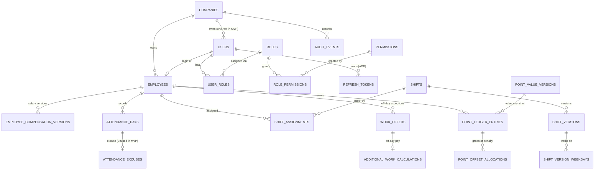

# 08 — Database Schema

| Field | Value |
|---|---|
| **Version** | 3.1 |
| **Status** | Final draft. Sections 2 to 3.4 describe `apps/api/prisma/schema.prisma` (the 2026-10-22 model) plus additive **[ADD]** changes; §3.5 onward are later-phase tables. Reconciled with planning spec v0.3.0 (single-company behaviour, tenancy-ready data, EGP only); decisions in `09-DECISION_LOG.md`. |
| **Last Updated** | 2026-10-22 |
| **Source of Truth** | The finalization prompt ("SoT") overrides older documents. PostgreSQL is the single source of truth (SoT §20, §25). Only tables with real value are included. |

---

## 1. Conventions
- PKs: `uuid` (`gen_random_uuid()`), except `audit_logs`/`outbox_events` (`bigserial`) and `settings` (`key`), `payroll_months` (`month`).
- Times: `timestamptz` (UTC). Business dates: `date` (Africa/Cairo calendar date). Months: `date` = first day of month.
- Money: `NUMERIC(14,2)`, always EGP (CONFIRMED). There is no USD column, no FX rate and no conversion anywhere (DN-23: integer piasters were proposed, not adopted).
- Enums (PostgreSQL `ENUM` or `text + CHECK`): `point_type` {GREEN, WHITE, RED, BLACK} · `entry_kind` {AWARD, REVERSAL} · `point_source` {ATTENDANCE, OVERTIME, ADMIN} · `attendance_status` {CONFIRMED, ABSENT, EXEMPT} · `verification_status` {PENDING, CONFIRMED, EXPIRED} · `leave_type` {ANNUAL, SICK, UNPAID} · `request_status` {PENDING, APPROVED, REJECTED, CANCELLED} · `offset_kind` {APPLY, UNDO} · `fund_tx_type` {MONTH_CLOSE_CREDIT, WITHDRAWAL, WITHDRAWAL_REFUND, ADJUSTMENT} · `payout_status` {PENDING, PROCESSING, PAID, FAILED} · `payout_provider` {PAYMOB, MANUAL} · `method_type` {WALLET, BANK} · `month_status` {OPEN, LOCKED}.
- Prisma note: partial unique indexes, CHECK and exclusion constraints and triggers are created by raw SQL in `apps/api/prisma/migrations` (`20261025000100_integrity_rules`, `20261025000200_audit_append_only`); the schema and the baseline migration come from `schema.prisma`. Never use `db push` on a shared database. Not yet created: the `point_state` view and the ledger triggers (Phase 4).
- **Name map** (older names still used in `02`, `05`, `07` → schema names): `users` (employee fields) → `employees`; `attendance` → `attendance_days`; `point_transactions` → `point_ledger_entries`; `point_offsets` → `point_offset_allocations`; `audit_logs` → `audit_events`; `work_schedules` / `schedule_assignments` → `shift_versions` / `shift_assignments`; `off_day_work_exceptions` → `work_offers`; `employee_salaries` → `employee_compensation_versions`.
- Extensions: `pgcrypto` (UUID), `btree_gist` (exclusion constraints).

## 2. ERD (models that exist in `apps/api/prisma/schema.prisma`)

Later-phase tables (§3.5 onward) are not in the schema yet; they follow the rule at the top of §3.5.

## 3. Tables

> `NN` = NOT NULL. **[ADD]** marks a change to make in `schema.prisma` (additive only; nothing is removed). Every company-owned table carries `company_id uuid NN FK → companies` (REQ-NFR-008); it is omitted from the column lists below to keep them short.

### 3.0 Deployment scope: multi-company foundation (spec REQ-031–033, REQ-NFR-009, v0.4.0)

- The MVP supports **several companies**, each fully isolated. Every account belongs to **exactly one company** (`users.company_id`); a person in several companies is Later. An account's company never changes.
- Companies are created **only by a provisioning command** (operator access, protected by a secret), together with the first Admin, in one transaction. There is no public company sign-up and no platform console in the MVP (REQ-031).
- Employees join through `company_invitations` created by their company's Admin; the invitation token is stored only as a hash and is single-use, expiring and revocable (REQ-032).
- Every company-owned table carries `company_id`. The company of a request comes from the **authenticated session**, never from client input; records of another company answer **404**; refresh re-derives the company from the account (REQ-033).
- Per-company configuration is keyed by company (`settings` PK `(company_id, key)`). Which settings are per company versus platform-wide (Paymob account, fees, legal gate, payroll timing) is open: **GAP-027**.
- Email addresses are globally unique; normalize to lowercase before writes and lookups.

### 3.1 Identity & access

#### `companies`
| Column | Type | Notes |
|---|---|---|
| id | uuid PK | |
| owner_user_id | uuid UNIQUE FK → users | nullable; the first Admin set by provisioning |
| name | text NN | |
| slug | text NN UNIQUE | |
| is_active | bool NN default true | |

#### `company_invitations`
Employee onboarding (REQ-032): email, full_name, employee_number, `token_hash` UNIQUE (never the raw token), status enum `PENDING/ACCEPTED/REVOKED/EXPIRED`, `expires_at`, `accepted_at`, `revoked_at`, `invited_by_user_id`. Rules: one `PENDING` invitation per company and per email and per employee code (partial unique indexes in the database, backed by a friendly 409 in the service); an email that already has an account cannot be invited; acceptance creates the user, role link and employee record in the inviter's company in one transaction.

#### `users` (login accounts)
| Column | Type | Notes |
|---|---|---|
| id | uuid PK | Also the **per-user lock row** (`SELECT … FOR UPDATE`). |
| email | text NN UNIQUE | lowercase |
| password_hash | text NN | argon2id |
| is_active | bool NN default true | disabled users cannot log in or refresh |
| must_change_password | bool NN default false | **[ADD]** set by admin reset (FR-AUTH-5) |
| created_at / updated_at | timestamptz NN | |

#### `employees` (the person who works; 0..1 per user)
| Column | Type | Notes |
|---|---|---|
| id | uuid PK | |
| user_id | uuid UNIQUE FK → users | nullable (an Admin may have no employee record) |
| employee_number | text NN | UNIQUE per company |
| full_name | text NN | |
| current_shift_id | uuid NN | FK `(company_id, current_shift_id)` → `shifts(company_id, id)` |
| is_active | bool NN default true | |
| phone | text | optional contact (kept from the Step 1.4 API) |
| active_from | date NN | **[ADD]** first date a BLACK may be created (join/reactivation date) |
| deactivated_at | timestamptz | **[ADD]** no BLACK from this Cairo date on |

Absence eligibility for date `d`: `d >= active_from AND (deactivated_at IS NULL OR d < date(deactivated_at at Cairo))`.

#### `roles`, `permissions`, `role_permissions`, `user_roles`
- `roles(id, name UNIQUE, description, is_system)`. Seeded: `ADMIN`, `EMPLOYEE` only.
- `permissions(id, code UNIQUE, description)`; codes follow `resource.action.scope` (e.g. `points.reverse.any`).
- `role_permissions(role_id, permission_id)` PK both.
- `user_roles(user_id, role_id)` PK both, `assigned_by_user_id`, `assigned_at`. **MVP rule: exactly one role per user**, enforced by the users service (FR-AUTH-3); the many-to-many shape is kept for future roles.

#### `refresh_tokens` **[ADD]**
| Column | Type | Notes |
|---|---|---|
| id | uuid PK | |
| user_id | uuid NN FK → users | |
| family_id | uuid NN | rotation family |
| token_hash | text NN UNIQUE | SHA-256; raw token never stored |
| expires_at | timestamptz NN | 30 days by default (DN-22) |
| revoked_at | timestamptz | |
| replaced_by | uuid | next token in chain |
| user_agent | text | |

Indexes: `(user_id)`, `(family_id)`, `(expires_at)`. User-owned, so no `company_id`.

#### `settings` **[ADD]**
`company_id` + `key` text (PK both) · `value` jsonb NN · `updated_by` uuid FK · `updated_at` timestamptz NN. Keys and defaults: §3.8.

#### `company_policy_versions`
`id`, `timezone` text NN (MVP: `Africa/Cairo`), `monthly_hours_divisor` int NN, `effective_from` date NN, `effective_to` date, `created_by_user_id`. **`monthly_hours_divisor` is not used for any pay in the MVP**: off-day pay always divides by 30 (FR-CAL-3).

#### `employee_compensation_versions` (Prisma model `EmployeeSalaryVersion`)
| Column | Type | Notes |
|---|---|---|
| id | uuid PK | |
| employee_id | uuid NN FK → employees | |
| salary | numeric(14,2) NN | monthly EGP; must be > 0 (service rule) |
| effective_from | date NN | provisional: 1st of month (DN-11), as the Step 1.4 API enforces |
| effective_to | date | null = current |
| created_by_user_id | uuid FK → users | |

Constraint **[ADD]**: `UNIQUE (employee_id, effective_from)`. Rows are never edited; locked months stay reproducible. Payroll resolves one version per employee per month; off-day pay uses the version effective that day.

### 3.2 Scheduling, calendar, locations

#### `shifts`
`id`, `name` (UNIQUE per company), `is_active`; `UNIQUE (company_id, id)` for composite FKs.

#### `shift_versions` (effective-dated hours and the CONFIRMED check-in windows)
| Column | Type | Notes |
|---|---|---|
| id | uuid PK | |
| shift_id | uuid NN FK → shifts | |
| start_time / end_time | time NN | default 08:00 / 16:00 |
| early_minutes | int NN default 60 | **[ADD]** end of the GREEN window, minutes after `start_time` |
| grace_minutes | int NN | end of the WHITE window (default **120**); later check-ins are RED |
| red_period_minutes | int NN | end of the RED window = absence threshold (default **240**); from then on BLACK |
| effective_from / effective_to | date | |
| created_by_user_id | uuid FK → users | |

Rule: `0 < early_minutes < grace_minutes < red_period_minutes` and `start + red_period < end`. With the defaults: GREEN 08:00–08:59, WHITE 09:00–09:59, RED 10:00–11:59, BLACK from 12:00 (spec REQ-012). *Reading `grace_minutes` and `red_period_minutes` as WHITE-end and RED-end is the reconciliation's interpretation of the 2026-10-22 model (see `09-DECISION_LOG.md`).*

`shift_version_weekdays(company_id, shift_version_id, weekday smallint)` PK all three: the working weekdays of a version (one start/end for all listed days).

#### `shift_assignments`
`id`, `employee_id`, `shift_id`, `effective_from` date NN, `effective_to` date (null = open), `assigned_by_user_id`. No overlapping assignments per employee (exclusion constraint `shift_assignments_no_overlap_excl`). Changing shifts updates `employees.current_shift_id` and closes/creates assignment rows in one transaction.

#### `locations`, `employee_locations`, `holidays` (Phase 2, not in the schema yet)
- `locations(id, name, latitude/longitude numeric(9,6), radius_m int default 50, qr_secret bytea, active)`.
- `employee_locations(employee_id, location_id)` PK both.
- `holidays(id, holiday_date UNIQUE per company, name, created_by)`. Weekly off days live in `settings.weekly_off_days`.

#### `work_offers` (the off-day-work exception record, FR-CAL-3)
| Column | Type | Notes |
|---|---|---|
| id | uuid PK | |
| employee_id | uuid NN FK → employees | |
| offer_type | text NN | MVP value: `OFF_DAY_WORK` only |
| starts_at / ends_at | timestamptz NN | the Cairo off day granted |
| status | text NN default `ACTIVE` | `ACTIVE` / `CANCELLED` |
| description | text NN | admin reason (audited) |
| created_by_user_id | uuid NN FK → users | admin who granted it |
| cancelled_by_user_id / cancelled_at | uuid / timestamptz | |

Rule: at most one `ACTIVE` offer per employee per Cairo date (service rule). A worked offer day yields **exactly 1 GREEN regardless of check-in time** and the day's pay below.

#### `additional_work_calculations` (the off-day pay record)
| Column | Type | Notes |
|---|---|---|
| id | uuid PK | |
| work_offer_id | uuid NN UNIQUE FK → work_offers | one calculation per offer |
| attendance_day_id | uuid NN FK → attendance_days | |
| eligible_minutes | int NN | informational only |
| green_points_awarded | int NN | always **1** (FR-CAL-3) |
| salary | numeric(14,2) NN | snapshot of the version effective that day |
| monthly_hours_divisor | int NN | MVP stores **30**, the confirmed day divisor; the column name is historical |
| pay_pounds | numeric(14,2) NN | `ROUND_HALF_UP(salary ÷ 30, 2)` |

Payroll sums `pay_pounds` into `payroll_records.off_day_pay`.

### 3.3 Attendance

#### `attendance_days` (one row per employee per Cairo date)
| Column | Type | Notes |
|---|---|---|
| id | uuid PK | |
| employee_id | uuid NN FK → employees | |
| shift_assignment_id | uuid FK | |
| work_date | date NN | Cairo date |
| timezone | text NN | snapshot |
| scheduled_start_at | timestamptz NN | snapshot of the window instants for that day |
| early_end_at | timestamptz NN | **[ADD]** start + early_minutes |
| grace_end_at | timestamptz NN | start + grace_minutes |
| red_period_end_at | timestamptz NN | start + red_period_minutes (absence threshold) |
| scheduled_end_at | timestamptz NN | |
| check_in_at / check_out_at | timestamptz | server time only |
| check_in_result | text NN default `SCHEDULED` | |
| classification | `PointType` | **[ADD]** the single point of the day (GREEN/WHITE/RED/BLACK); null while undecided or exempt |

Constraint: `UNIQUE (company_id, employee_id, work_date)`. The snapshot columns mean a later shift change never re-classifies a past day.
Phase 3 adds the remaining check-in evidence columns from the earlier design: check-in/out location, latitude/longitude, accuracy, `confirmed_at`, `overtime_greens`, `left_early`, `early_leave_request_id`, `entry_source`, `classification_rev`.

#### `attendance_verifications` (Phase 3, not in the schema yet)
GPS-validated attempts awaiting QR: `employee_id`, `work_date`, `location_id`, status `PENDING/CONFIRMED/EXPIRED`, `started_at`, `expires_at = started_at + 15 min`, `confirmed_at`, coordinates, `accuracy_m`. Partial `UNIQUE (employee_id, work_date) WHERE status='PENDING'`.

#### `attendance_excuses` (unused in MVP)
`attendance_day_id` UNIQUE, `submitted_by_user_id`, `employee_reason`, status (`PENDING`), `decided_by_user_id`, `decision_reason`, `decided_at`. No spec requirement defines an employee excuse flow (**DN-26**); no MVP endpoint writes it.

### 3.4 Points

#### `point_value_versions`
| Column | Type | Notes |
|---|---|---|
| id | uuid PK | |
| point_type | `PointType` NN | only GREEN, RED, BLACK (WHITE has no money value); enforced by CHECK `point_value_no_white_check` |
| value | numeric(14,2) NN | EGP per point; must be > 0 |
| effective_from / effective_to | date | |
| created_by_user_id | uuid FK → users | |

Constraint **[ADD]**: `UNIQUE (company_id, point_type, effective_from)`. Seeds: GREEN **1000.00**, RED 250.00, BLACK 1000.00 EGP. The GREEN value is Admin-configurable and audited. RED/BLACK potentials use the version effective on the work date; the GREEN version that feeds the Fund credit is **DN-21** (provisional: value at Month Close).

#### `point_ledger_entries` (**append-only ledger**)
| Column | Type | Notes |
|---|---|---|
| id | uuid PK | |
| employee_id | uuid NN FK → employees | |
| point_type | `PointType` NN | |
| entry_kind | text NN | `AWARD` / `REVERSAL` (enum recommended) |
| direction | smallint NN | `+1` award, `−1` reversal |
| quantity | int NN | `> 0`; one row may carry N points of one source |
| point_value_version_id | uuid FK | |
| value_per_point_piasters | bigint NN | snapshot (DN-23: the only piaster column) |
| source_type / source_id | text NN / uuid | `ATTENDANCE`, `OVERTIME`, `OFF_DAY_WORK`, `ADMIN` |
| idempotency_key | text NN UNIQUE | replaces the earlier `dedupe_key` |
| reverses_entry_id | uuid FK self | a reversal references the entry it reverses |
| reason | text | mandatory for `ADMIN` and `REVERSAL` |
| created_by_user_id | uuid FK | null = system |
| created_at | timestamptz NN | |

Rules: never UPDATE/DELETE (trigger with the Phase 4 migrations); an entry is reversed at most once; the net points of an entry are `direction × quantity`. The offset engine treats each unit of `quantity` as one point.

#### `point_offset_allocations`
`green_entry_id` → GREEN entry, `penalty_entry_id` → RED or BLACK entry, `quantity` (Greens used), `created_at`; `UNIQUE (green_entry_id, penalty_entry_id)`. One RED needs 1 Green, one BLACK needs exactly 5 (no partial). How an offset is **undone** after a reversal (the earlier design used `APPLY`/`UNDO` rows) is open: **U-5**, to settle in Phase 4.

#### `point_state` (VIEW, Phase 4)
Derives `AVAILABLE / CONSUMED / SETTLED_TO_FUND / REVERSED / CANCELLED / ACTIVE / RECORDED` from the immutable rows (`05-SYSTEM_DESIGN.md` §5.2).

#### `audit_events` (append-only; replaces the earlier `audit_logs`)
`id`, `actor_user_id` (null = system), `action` (e.g. `point.reverse`), `target_type`, `target_id`, `reason`, `changes` jsonb (before/after), `created_at`; **[ADD]** `actor_type` (`ADMIN`/`EMPLOYEE`/`SYSTEM`/`PROVIDER`) and `request_id`. Index `(company_id, target_type, target_id, created_at DESC)`.

### 3.5 Leave

> **Rule for §3.5 to §3.8 (later-phase tables, not in the schema yet):** when a table is added it gets `company_id` (REQ-NFR-008); employee-owned data references `employees.id` where the text says `user_id`; money stays `numeric(14,2)` EGP. Column lists below are otherwise the agreed design.

#### `leave_requests`
| Column | Type | Notes |
|---|---|---|
| id | uuid PK | |
| user_id | uuid NN FK | |
| leave_type | leave_type NN | |
| from_date, to_date | date NN | `CHECK (to_date >= from_date)` |
| reason | text | |
| status | request_status NN default 'PENDING' | |
| reviewed_by | uuid FK | |
| reviewed_at | timestamptz | |
| review_note | text | |
| cancelled_by / cancelled_at | uuid / timestamptz | |
| updated_at | timestamptz NN | |

Constraints: `EXCLUDE USING gist (user_id WITH =, daterange(from_date, to_date, '[]') WITH &&) WHERE (status IN ('PENDING','APPROVED'))`.
Indexes: `(user_id, from_date)`, `(status, created_at)`. No `leave_days` table: covered working days are computed from the calendar (value too low to justify a table).

#### `early_leave_requests`
| Column | Type | Notes |
|---|---|---|
| id | uuid PK | |
| user_id | uuid NN FK | |
| work_date | date NN | |
| requested_checkout_time | time NN | |
| reason | text NN | |
| status | request_status NN default 'PENDING' | only PENDING/APPROVED/REJECTED/CANCELLED(employee) used |
| reviewed_by / reviewed_at / review_note | uuid / timestamptz / text | |
| updated_at | timestamptz NN | |

Constraint: partial `UNIQUE (user_id, work_date) WHERE status IN ('PENDING','APPROVED')`. Index `(status, created_at)`.

### 3.6 Payroll & Fund

#### `payroll_months`
| Column | Type | Notes |
|---|---|---|
| month | date PK | first day; `CHECK (EXTRACT(day FROM month) = 1)` |
| status | month_status NN default 'OPEN' | |
| locked_at | timestamptz | |
| locked_by | uuid FK | |

`CHECK (status='OPEN' OR (locked_at IS NOT NULL AND locked_by IS NOT NULL))`. No exchange rate is stored (EGP only). A month with no row is OPEN. Once `LOCKED` the row can never change (trigger).

#### `payroll_records`
Purpose: immutable monthly snapshot per employee.
| Column | Type | Notes |
|---|---|---|
| id | uuid PK | |
| month | date NN FK payroll_months | |
| user_id | uuid NN FK | |
| base_salary | numeric(14,2) NN | snapshot |
| working_days | smallint NN | |
| partial_month | bool NN default false | DN-11 flag |
| leave_days_by_type | jsonb NN | `{ANNUAL, SICK, UNPAID}` |
| leave_deduction | numeric(14,2) NN | |
| whites | int NN | informational |
| greens_earned / greens_consumed / greens_remaining | int NN | `CHECK (greens_remaining = greens_earned − greens_consumed AND greens_remaining >= 0)` |
| reds_active / blacks_active | int NN | after offsets |
| reds_cancelled / blacks_cancelled | int NN | informational |
| potential_red / potential_black | numeric(14,2) NN | |
| applied_red / applied_black | numeric(14,2) NN | per policy |
| off_day_days | smallint NN default 0 | granted off-day-work days worked (FR-CAL-3) |
| off_day_pay | numeric(14,2) NN default 0 | `Σ ROUND_HALF_UP(salary ÷ 30, 2)` per such day |
| adjustments_total | numeric(14,2) NN | |
| net_payroll_egp | numeric(14,2) NN | `= base − leave_deduction − applied_red − applied_black + off_day_pay + adjustments_total` |
| fund_credit_egp | numeric(14,2) NN | `= greens_remaining × GREEN value` (EGP) |
| policy_snapshot | jsonb NN | deduction/leave policies, point values used |

Constraint: `UNIQUE (month, user_id)`. Index `(user_id, month)`. Trigger: no INSERT/UPDATE/DELETE once month is locked.

#### `payroll_adjustments` — append-only
| Column | Type | Notes |
|---|---|---|
| id | uuid PK | |
| user_id | uuid NN FK | |
| applies_to_month | date NN | first-of-month; must be OPEN (trigger) |
| amount_egp | numeric(14,2) NN | `CHECK <> 0` (signed) |
| reason | text NN | |
| corrects_month | date | reference when fixing a locked month |
| created_by | uuid NN FK | |

Index `(user_id, applies_to_month)`.

#### `fund_transactions` — **append-only ledger**
| Column | Type | Notes |
|---|---|---|
| id | uuid PK | |
| user_id | uuid NN FK | |
| type | fund_tx_type NN | |
| amount | numeric(14,2) NN | EGP, signed. For `WITHDRAWAL` this is the requested amount (the employee bears the fee; see `payouts`). |
| currency | char(3) NN default 'EGP' | `CHECK = 'EGP'` |
| payroll_month | date | for MONTH_CLOSE_CREDIT |
| payroll_record_id | uuid FK | |
| payout_id | uuid FK payouts | WITHDRAWAL / WITHDRAWAL_REFUND |
| idempotency_key | text | admin adjustments |
| reason | text | mandatory for ADJUSTMENT |
| actor_id | uuid FK | null = system/employee-initiated |

Constraints:
- `CHECK ((type='MONTH_CLOSE_CREDIT' AND amount > 0 AND payroll_month IS NOT NULL) OR (type='WITHDRAWAL' AND amount < 0 AND payout_id IS NOT NULL) OR (type='WITHDRAWAL_REFUND' AND amount > 0 AND payout_id IS NOT NULL) OR (type='ADJUSTMENT' AND amount <> 0 AND reason IS NOT NULL AND actor_id IS NOT NULL))`.
- Partial `UNIQUE (user_id, payroll_month) WHERE type='MONTH_CLOSE_CREDIT'`.
- Partial `UNIQUE (payout_id) WHERE type='WITHDRAWAL'` and `UNIQUE (payout_id) WHERE type='WITHDRAWAL_REFUND'`.
- Partial `UNIQUE (idempotency_key) WHERE idempotency_key IS NOT NULL`.
- Triggers: append-only; hardening — a negative row is rejected if `SUM(amount) + new < 0` (valid under the user lock).
Indexes: `(user_id, created_at)`; balance = `SUM(amount)` per user.

### 3.7 Payments

#### `payout_methods`
Immutable account details; changing creates a new row.
| Column | Type | Notes |
|---|---|---|
| id | uuid PK | |
| user_id | uuid NN FK | |
| method_type | method_type NN | WALLET / BANK |
| issuer | text NN | wallet provider or bank |
| account_encrypted | bytea NN | AES-256-GCM |
| account_last4 | text NN | display |
| holder_name | text NN | |
| is_active | bool NN default true | |
| cooldown_until | timestamptz | after change (DN-13) |
| deactivated_at | timestamptz | |

Constraint: partial `UNIQUE (user_id) WHERE is_active` (one active method, MVP).

#### `payouts`
| Column | Type | Notes |
|---|---|---|
| id | uuid PK | |
| user_id | uuid NN FK | |
| payout_method_id | uuid NN FK | |
| amount_egp | numeric(14,2) NN | requested amount, debited from the fund. `CHECK > 0` |
| fee_egp | numeric(14,2) NN default 0 | Paymob fee snapshot, borne by the employee (CONFIRMED). `CHECK >= 0` |
| net_egp | numeric(14,2) NN | `= amount_egp − fee_egp`, paid to the employee. `CHECK > 0` |
| status | payout_status NN default 'PENDING' | |
| provider | payout_provider NN default 'PAYMOB' | MANUAL when resolved manually |
| provider_reference | text | |
| client_reference | text NN | **UNIQUE** — idempotency toward Paymob |
| idempotency_key | text NN | client key |
| request_hash | text NN | detects key reuse with different payload |
| failure_reason | text | |
| attempts | int NN default 0 | |
| last_attempt_at / next_inquiry_at | timestamptz | |
| needs_attention | bool NN default false | |
| processed_at | timestamptz | |
| resolved_by / resolution_note | uuid FK / text | manual fallback |
| updated_at | timestamptz NN | |

Constraints: `UNIQUE (client_reference)`, `UNIQUE (user_id, idempotency_key)`. Trigger: `PAID`/`FAILED` are terminal. Indexes: `(status, next_inquiry_at)`, `(user_id, created_at)`, `(needs_attention) WHERE needs_attention`.

#### `payment_webhook_events`
| Column | Type | Notes |
|---|---|---|
| id | uuid PK | |
| provider | text NN | |
| event_key | text NN | provider event id or SHA-256 of body |
| payout_id | uuid FK | when resolvable |
| signature_valid | bool NN | |
| payload | jsonb NN | sensitive fields redacted |
| received_at | timestamptz NN | |
| processed_at | timestamptz | |

Constraint: `UNIQUE (provider, event_key)`.

### 3.8 Platform

#### `outbox_events` (only for payouts in MVP)
| Column | Type | Notes |
|---|---|---|
| id | bigserial PK | |
| aggregate_type / aggregate_id | text NN / uuid NN | e.g., `payout` |
| event_type | text NN | `PAYOUT_SEND`, `PAYOUT_INQUIRE` |
| payload | jsonb NN | |
| status | text NN default 'PENDING' | `CHECK IN ('PENDING','PUBLISHED')` |
| attempts | int NN default 0 | |
| available_at | timestamptz NN default now() | |
| published_at | timestamptz | |

Index: `(id) WHERE status='PENDING'`.

#### `notifications`
`id`, `user_id` FK, `type` text, `title` text, `body` text, `data` jsonb, `read_at` timestamptz. Index `(user_id, read_at, created_at DESC)`. (Push delivery is Later.)

#### `audit_logs` — superseded by `audit_events` (§3.4); kept here only as the column reference for `changes` (before/after), `request_id`, `ip`
| Column | Type | Notes |
|---|---|---|
| id | bigserial PK | |
| actor_id | uuid FK | null for SYSTEM |
| actor_type | text NN | `ADMIN`/`EMPLOYEE`/`SYSTEM`/`PROVIDER` |
| action | text NN | e.g., `point.reverse` |
| entity_type | text NN | |
| entity_id | text NN | |
| before / after | jsonb | |
| request_id | text | |
| ip | inet | |

Indexes: `(entity_type, entity_id)`, `(actor_id, created_at)`, `(created_at)`.

#### `settings`
PK `(company_id, key)` · `value` jsonb NN · `updated_by` uuid FK · `updated_at` timestamptz NN (model defined in §3.1).
| Key | Default | Notes |
|---|---|---|
| `timezone` | `"Africa/Cairo"` | read-only |
| `weekly_off_days` | *(admin sets, DN-10)* | e.g., `["FRI","SAT"]` |
| `gps_max_accuracy_m` | 50 | DN-14 |
| `qr_verification_window_minutes` | 15 | SoT |
| `qr_rotation_seconds` | 30 | |
| `overtime_unit_minutes` | 60 | SoT |
| `overtime_daily_cap` | null | DN-07 |
| `offset_reds_per_green` | 1 | SoT (1 Green : 1 Red) |
| `offset_greens_per_black` | 5 | SoT |
| `deduction_policy` | `{red_enabled:false, black_enabled:false, cap_percent_of_base:null}` | DN-01 |
| `leave_pay_policy` | `{ANNUAL:{unpaid:false}, SICK:{unpaid:false}, UNPAID:{unpaid:true}}` | DN-02 |
| `withdrawal_limits` | `{min_egp:null, daily_max_egp:null, monthly_max_egp:null}` | DN-13; `min_egp` must exceed the fee |
| `paymob_fee_schedule` | `null` (effective-dated; values are an accepted gap) | DN-13; withdrawals stay disabled in production until set |
| `payout_method_cooldown_hours` | null | DN-13 |
| `absence_lookback_days` | 7 | catch-up window |
| `admin_point_max_quantity` | null | DN-18 |
| `stuck_processing_alert_hours` | 72 | |

## 4. Database Invariants

| # | Invariant | Enforced by | Tested by |
|---|---|---|---|
| I1 | One attendance per employee per date | `UNIQUE(attendance.user_id, work_date)` | integration: duplicate check-in |
| I2 | One attendance classification per day | `attendance` CHECK + unique `dedupe_key ATT:{user}:{date}:{rev}` + trigger "no second un-reversed ATTENDANCE award for (user,date)" | correction invariant test |
| I3 | No duplicated absence point | I1 + `INSERT … ON CONFLICT DO NOTHING` + I2 | repeated absence job |
| I4 | A point can be reversed once; reversals are not reversible | `UNIQUE(reverses_id)` + trigger (target must be AWARD, same user/type/month) | double reversal concurrency |
| I5 | Green cannot be consumed twice | `UNIQUE(source_point_id, source_gen)` + trigger "no active APPLY on source" + user lock | double cancellation concurrency |
| I6 | Black cancels only as a full group of 5 (no partial) | deferred constraint trigger on group size | unit + integration |
| I7 | WHITE never participates in offsets | trigger (types) | unit |
| I8 | Offsets only affect open months | trigger checks `payroll_months` for both points | integration |
| I9 | Locked month cannot be mutated directly | triggers on `point_transactions`, `point_offsets`, `payroll_records`, `payroll_adjustments`, `payroll_months` | Phase 6 DB test |
| I10 | Point ledger append-only | no UPDATE/DELETE privilege + trigger | Phase 4 DB test |
| I11 | Fund ledger append-only | no UPDATE/DELETE privilege + trigger | DB test |
| I12 | Fund balance never negative | user lock + negative-row trigger | concurrent withdrawals |
| I13 | One month-close credit per user/month | partial unique | close twice |
| I14 | One debit and at most one refund per payout | partial uniques on `payout_id` | failure path test |
| I15 | Payout idempotency key unique | `UNIQUE(client_reference)`, `UNIQUE(user_id, idempotency_key)` | duplicate request test |
| I16 | Terminal payout states are immutable | trigger | unit/integration |
| I17 | One `PENDING` verification per user/day; attendance never exists before QR success | partial unique + service | check-in tests |
| I18 | No overlapping schedule assignments / leave requests | exclusion constraints | integration |
| I19 | Greens consumed by offsets never counted in Fund | `payroll_records` CHECK `remaining = earned − consumed`; credit = remaining | G1/G3 golden |
| I20 | Audit log append-only | privileges + trigger | DB test |

## 5. Triggers and Privileges (summary)

| Object | Rule |
|---|---|
| App DB role | `INSERT, SELECT` only on `point_transactions`, `point_offsets`, `fund_transactions`, `audit_logs`, `payroll_adjustments`; no `UPDATE/DELETE/TRUNCATE`. Separate migration role owns DDL. |
| `trg_append_only` | `BEFORE UPDATE OR DELETE` raises on the five tables above (defense if privileges are misconfigured). |
| `trg_point_guard` | `BEFORE INSERT` on `point_transactions`: month open; reversal consistency; one active ATTENDANCE award per `(user, work_date)`. |
| `trg_offset_guard` | `BEFORE INSERT` on `point_offsets`: types, months open, no double consumption/cancellation. |
| `trg_offset_group_complete` | `DEFERRABLE INITIALLY DEFERRED` constraint trigger: group size is 1 (Red) or `offset_greens_per_black` (Black). |
| `trg_month_lock` | Blocks writes to `payroll_records`, `payroll_adjustments` (by `applies_to_month`) and any update of a `LOCKED` `payroll_months` row. |
| `trg_fund_guard` | Negative balance protection (see I12). |
| `trg_payout_terminal` | Rejects status change out of `PAID`/`FAILED`. |

## 6. Transaction Design (reference)

Full table in `05-SYSTEM_DESIGN.md` §14. Core shapes:

**Check-in confirm:** `BEGIN → lock user → validate verification + attendance uniqueness → create attendance → create point → run offset engine → COMMIT`.
**Withdrawal:** `BEGIN → lock user → idempotency + validations + balance → create payout → create debit ledger row → create outbox event → COMMIT`; Paymob is called later by a worker.
**Month Close:** `BEGIN → lock payroll_months row → lock users ascending → (offset engine + record + fund credit) per employee → mark LOCKED → COMMIT`.
Never inside a transaction: Redis calls, Paymob calls, any external network call.

## 7. Seed Data
- `companies`: none are seeded in production. A company and its first Admin come from the provisioning command (TASK-043, `docs/11-PROVISIONING_RUNBOOK.md`); the development seed creates one sample company through the same function.
- `roles`: ADMIN, EMPLOYEE; `permissions` + `role_permissions` for both (EMPLOYEE: `*.own` set).
- `point_value_versions`: GREEN 1000.00 EGP, RED 250.00 EGP, BLACK 1000.00 EGP (effective from go-live month start); EGP only.
- `shifts` + `shift_versions`: "Default 08-16" (08:00, 16:00, early 60, grace 120, red period 240), weekdays Sunday–Thursday.
- `company_policy_versions`: not seeded until a feature reads it.
- `settings`: defaults above; `weekly_off_days` = `["FRI","SAT"]` as a development default (DN-10). A re-run never overwrites a value an Admin changed.
- First `ADMIN`: a `users` row + `user_roles` ADMIN, created by a one-time bootstrap command with forced password change (no self-registration; the development seed account must not exist in production).
