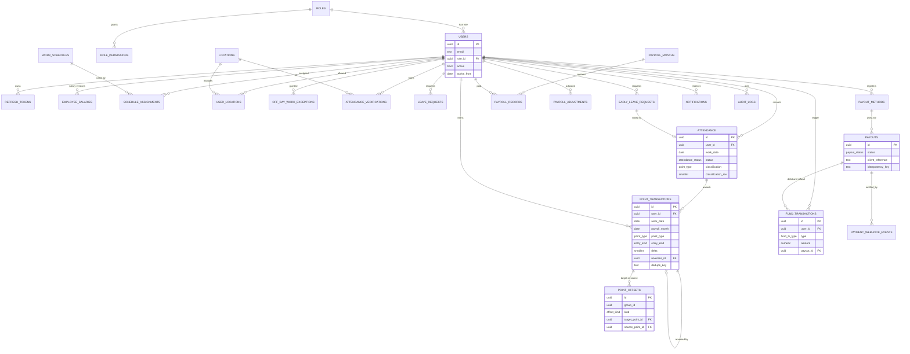

# 08 — Database Schema

| Field | Value |
|---|---|
| **Version** | 3.0 |
| **Status** | Final draft — implementation-ready |
| **Last Updated** | 2026-10-08 |
| **Source of Truth** | The finalization prompt ("SoT") overrides older documents. PostgreSQL is the single source of truth (SoT §20, §25). Only tables with real value are included. |

---

## 1. Conventions
- PKs: `uuid` (`gen_random_uuid()`), except `audit_logs`/`outbox_events` (`bigserial`) and `settings` (`key`), `payroll_months` (`month`).
- Times: `timestamptz` (UTC). Business dates: `date` (Africa/Cairo calendar date). Months: `date` = first day of month.
- Money: `NUMERIC(14,2)`; FX rate `NUMERIC(12,6)`. EGP unless the column says `usd`.
- Enums (PostgreSQL `ENUM` or `text + CHECK`): `point_type` {GREEN, WHITE, RED, BLACK} · `entry_kind` {AWARD, REVERSAL} · `point_source` {ATTENDANCE, OVERTIME, ADMIN} · `attendance_status` {CONFIRMED, ABSENT, EXEMPT} · `verification_status` {PENDING, CONFIRMED, EXPIRED} · `leave_type` {ANNUAL, SICK, UNPAID} · `request_status` {PENDING, APPROVED, REJECTED, CANCELLED} · `offset_kind` {APPLY, UNDO} · `fund_tx_type` {MONTH_CLOSE_CREDIT, WITHDRAWAL, WITHDRAWAL_REFUND, ADJUSTMENT} · `payout_status` {PENDING, PROCESSING, PAID, FAILED} · `payout_provider` {PAYMOB, MANUAL} · `method_type` {WALLET, BANK} · `month_status` {OPEN, LOCKED}.
- Prisma note: partial unique indexes, exclusion constraints, triggers and the `point_state` view are created by raw SQL migrations.
- Extensions: `pgcrypto` (UUID), `btree_gist` (exclusion constraints).

## 2. ERD

Tables not drawn (no FK of interest): `holidays`, `point_values`, `settings`, `outbox_events`, `work_schedules` (shown), `payroll_months` (shown).

## 3. Tables

> `NN` = NOT NULL. All tables also have `created_at timestamptz NN default now()` unless noted; `updated_at` only where state is mutable.

### 3.1 Identity & access

#### `roles`
Purpose: RBAC foundation. Seeded: `ADMIN`, `EMPLOYEE` only.
| Column | Type | Notes |
|---|---|---|
| id | uuid PK | |
| code | text NN | UNIQUE |
| name | text NN | |

#### `role_permissions`
Purpose: permission strings per role. PK `(role_id, permission)`; `role_id` FK → roles.

#### `users`
Purpose: employees and admins.
| Column | Type | Notes |
|---|---|---|
| id | uuid PK | |
| employee_code | text | UNIQUE nullable |
| full_name | text NN | |
| email | text NN | UNIQUE index on `lower(email)` |
| phone | text | |
| password_hash | text NN | argon2id |
| must_change_password | bool NN default false | set by admin reset |
| role_id | uuid NN FK → roles | |
| active | bool NN default true | |
| active_from | date NN | first date Blacks may be created (hire/reactivation date) |
| disabled_at | timestamptz | `CHECK (active = (disabled_at IS NULL))` |
| updated_at | timestamptz NN | |

Indexes: `(role_id)`. Also used as the **per-user lock row** (`SELECT … FOR UPDATE`).
Absence eligibility for date `d`: `d >= active_from AND (disabled_at IS NULL OR d < date(disabled_at at Cairo))`.

#### `refresh_tokens`
| Column | Type | Notes |
|---|---|---|
| id | uuid PK | |
| user_id | uuid NN FK | |
| family_id | uuid NN | rotation family |
| token_hash | text NN | UNIQUE (SHA-256) |
| expires_at | timestamptz NN | |
| revoked_at | timestamptz | |
| replaced_by | uuid | next token in chain |
| user_agent | text | |

Indexes: `(user_id)`, `(family_id)`, `(expires_at)`.

#### `employee_salaries`
Purpose: versioned base salary (replaces `users.base_salary`).
| Column | Type | Notes |
|---|---|---|
| id | uuid PK | |
| user_id | uuid NN FK | |
| amount | numeric(14,2) NN | `CHECK > 0` |
| currency | char(3) NN default 'EGP' | `CHECK = 'EGP'` |
| effective_from | date NN | `CHECK (EXTRACT(day FROM effective_from) = 1)` (provisional, DN-11) |
| created_by | uuid NN FK users | |

Constraints: `UNIQUE (user_id, effective_from)`.

### 3.2 Scheduling, calendar, locations

#### `work_schedules`
| Column | Type | Notes |
|---|---|---|
| id | uuid PK | |
| name | text NN UNIQUE | e.g., "Default 08-16" |
| work_start | time NN | 08:00 |
| work_end | time NN | 16:00; `CHECK (work_end > work_start)` |
| early_minutes | int NN default 60 | `CHECK > 0` |
| normal_minutes | int NN default 60 | `CHECK > 0` |
| late_minutes | int NN default 120 | `CHECK > 0` |
| active | bool NN default true | |
| updated_at | timestamptz NN | |

Service rule: `work_start + early + normal + late < work_end`.

#### `schedule_assignments`
| Column | Type | Notes |
|---|---|---|
| id | uuid PK | |
| user_id | uuid NN FK | |
| schedule_id | uuid NN FK | |
| effective_from | date NN | |
| effective_to | date | null = open-ended; `CHECK (effective_to >= effective_from)` |
| created_by | uuid NN FK | |

Constraints: **exclusion** `EXCLUDE USING gist (user_id WITH =, daterange(effective_from, effective_to, '[]') WITH &&)` (no overlaps). Index `(user_id, effective_from)`.

#### `locations`
| Column | Type | Notes |
|---|---|---|
| id | uuid PK | |
| name | text NN | |
| latitude / longitude | numeric(9,6) NN | range checks |
| radius_m | int NN | `CHECK > 0` |
| qr_secret | bytea NN | random; never exposed by API |
| active | bool NN default true | |
| updated_at | timestamptz NN | |

#### `user_locations`
PK `(user_id, location_id)`, both FK. Index `(location_id)`.

#### `holidays`
| Column | Type | Notes |
|---|---|---|
| id | uuid PK | |
| holiday_date | date NN | UNIQUE |
| name | text NN | |
| created_by | uuid FK | |

Weekly off days live in `settings.weekly_off_days`.

#### `off_day_work_exceptions`
Purpose: admin-granted permission to work on an off day (no Black, check-in allowed).
| Column | Type | Notes |
|---|---|---|
| id | uuid PK | |
| user_id | uuid NN FK | |
| work_date | date NN | |
| reason | text NN | |
| status | text NN default 'ACTIVE' | `CHECK IN ('ACTIVE','CANCELLED')` |
| granted_by | uuid NN FK | |
| cancelled_at | timestamptz | |

Constraint: partial `UNIQUE (user_id, work_date) WHERE status = 'ACTIVE'`.

### 3.3 Attendance

#### `attendance`
Purpose: one row per employee per date; holds the single classification.
| Column | Type | Notes |
|---|---|---|
| id | uuid PK | |
| user_id | uuid NN FK | |
| work_date | date NN | Cairo date |
| status | attendance_status NN | |
| classification | point_type | GREEN/WHITE/RED/BLACK or NULL (EXEMPT) |
| classification_rev | smallint NN default 1 | +1 on each correction |
| check_in_at | timestamptz | = verification `started_at` (classified instant); admin entry otherwise |
| confirmed_at | timestamptz | QR success time |
| check_in_location_id | uuid FK | |
| check_in_lat, check_in_lng | numeric(9,6) | |
| check_in_accuracy_m | numeric(7,2) | |
| check_out_at | timestamptz | |
| check_out_location_id | uuid FK | |
| check_out_lat, check_out_lng | numeric(9,6) | |
| check_out_accuracy_m | numeric(7,2) | |
| overtime_greens | smallint NN default 0 | units awarded |
| left_early | bool NN default false | checkout before shift end without approved early leave (DN-08) |
| early_leave_request_id | uuid FK | |
| entry_source | text NN | `CHECK IN ('SELF','ADMIN')` |
| schedule_id | uuid FK | |
| schedule_snapshot | jsonb NN | work_start/end + windows as applied that day |
| created_by | uuid FK | admin id for manual rows |
| updated_at | timestamptz NN | |

Constraints:
- `UNIQUE (user_id, work_date)`.
- `CHECK ((status='CONFIRMED' AND classification IN ('GREEN','WHITE','RED') AND check_in_at IS NOT NULL AND confirmed_at IS NOT NULL) OR (status='ABSENT' AND classification='BLACK') OR (status='EXEMPT' AND classification IS NULL))`.
- `CHECK (check_out_at IS NULL OR (check_in_at IS NOT NULL AND check_out_at > check_in_at))`, `CHECK (overtime_greens >= 0)`.
Indexes: `(work_date)`, `(user_id, work_date)` (covered by unique).

#### `attendance_verifications`
Purpose: GPS-validated check-in attempts awaiting QR (needed: attendance must not exist before QR success).
| Column | Type | Notes |
|---|---|---|
| id | uuid PK | |
| user_id | uuid NN FK | |
| work_date | date NN | |
| location_id | uuid NN FK | location matched by geofence |
| status | verification_status NN default 'PENDING' | |
| started_at | timestamptz NN | server time |
| expires_at | timestamptz NN | `started_at + qr_verification_window_minutes` (15); `CHECK (expires_at > started_at)` |
| confirmed_at | timestamptz | |
| latitude, longitude | numeric(9,6) NN | |
| accuracy_m | numeric(7,2) NN | |

Constraints: partial `UNIQUE (user_id, work_date) WHERE status='PENDING'`.
Indexes: `(status, expires_at)` (sweeper), `(user_id, work_date)`.

### 3.4 Points

#### `point_values`
Purpose: versioned money values. Seeds: GREEN 1.00 USD, RED 250.00 EGP, BLACK 1000.00 EGP. WHITE has no row.
| Column | Type | Notes |
|---|---|---|
| id | uuid PK | |
| point_type | point_type NN | `CHECK IN ('GREEN','RED','BLACK')` |
| currency | char(3) NN | USD for GREEN, EGP for RED/BLACK (`CHECK`) |
| amount | numeric(14,2) NN | `CHECK >= 0` |
| effective_from | date NN | |
| created_by | uuid FK | |

Constraint: `UNIQUE (point_type, effective_from)`. Value for a point = latest row with `effective_from <= work_date`.

#### `point_transactions`  — **append-only ledger**
Purpose: one row = one point awarded (+1) or one reversal (−1).
| Column | Type | Notes |
|---|---|---|
| id | uuid PK | |
| user_id | uuid NN FK | |
| work_date | date NN | |
| payroll_month | date NN | `CHECK (payroll_month = date_trunc('month', work_date)::date)` |
| point_type | point_type NN | |
| entry_kind | entry_kind NN | |
| delta | smallint NN | +1 award / −1 reversal |
| source | point_source NN | |
| reverses_id | uuid FK self | target of a reversal |
| reason_code | text | e.g., ADMIN_REVERSE, ADMIN_VOID, LEAVE_APPROVED, ATTENDANCE_CORRECTION |
| reason | text | mandatory for ADMIN and REVERSAL |
| attendance_id | uuid FK | ATTENDANCE/OVERTIME sources |
| classification_rev | smallint | ATTENDANCE source |
| dedupe_key | text | `ATT:{user}:{date}:{rev}` · `OT:{attendance}:{i}` · `ADM:{key}:{i}` |
| actor_type | text NN | `CHECK IN ('SYSTEM','ADMIN')` |
| actor_id | uuid FK | null for SYSTEM |
| batch_id | uuid | admin multi-unit add |

Constraints:
- `CHECK ((entry_kind='AWARD' AND delta=1 AND reverses_id IS NULL) OR (entry_kind='REVERSAL' AND delta=-1 AND reverses_id IS NOT NULL AND reason IS NOT NULL AND actor_type IS NOT NULL))`.
- `UNIQUE (reverses_id)` — a point can be reversed once.
- Partial `UNIQUE (dedupe_key) WHERE dedupe_key IS NOT NULL`.
- `CHECK (source <> 'ADMIN' OR (actor_id IS NOT NULL AND reason IS NOT NULL))`.
- Triggers (see §5): append-only; reversal must match target's user/type/month and target must be an AWARD; locked-month guard; one active ATTENDANCE award per `(user, work_date)`.
Indexes: `(user_id, payroll_month, point_type)`, `(user_id, work_date)`, `(attendance_id)`, `(created_at)`.

#### `point_offsets` — **append-only**
Purpose: allocation of Greens to cancel Reds/Blacks; UNDO rows release them.
| Column | Type | Notes |
|---|---|---|
| id | uuid PK | |
| user_id | uuid NN FK | |
| group_id | uuid NN | one group = 1 Green→1 Red, or 5 Greens→1 Black |
| position | smallint NN | 1..5 within a group |
| kind | offset_kind NN | APPLY / UNDO |
| target_point_id | uuid NN FK point_transactions | RED or BLACK |
| source_point_id | uuid NN FK point_transactions | GREEN |
| source_gen | smallint | APPLY: 1 + earlier APPLYs of this Green |
| target_gen | smallint | APPLY: 1 + earlier APPLY groups of this target |
| reverses_offset_id | uuid FK self | UNDO → the APPLY row |
| actor_type / actor_id | text / uuid | |
| reason | text | UNDO reason |

Constraints:
- `CHECK ((kind='APPLY' AND reverses_offset_id IS NULL AND source_gen >= 1 AND target_gen >= 1) OR (kind='UNDO' AND reverses_offset_id IS NOT NULL))`.
- `UNIQUE (reverses_offset_id)` (an APPLY row is undone once).
- Partial `UNIQUE (source_point_id, source_gen) WHERE kind='APPLY'` — **Green cannot be consumed twice** per generation.
- Partial `UNIQUE (target_point_id, target_gen) WHERE kind='APPLY' AND position=1` — one active group per target per generation.
- `UNIQUE (group_id, position)`.
- Triggers: types (`target ∈ {RED,BLACK}`, `source = GREEN`, never WHITE); both months open; no APPLY on a Green/target that already has an active APPLY; **deferred constraint trigger**: each new APPLY group has exactly 1 row (Red target) or `offset_greens_per_black` rows (Black target) — no partial Black cancellation.
Indexes: `(user_id)`, `(group_id)`, `(target_point_id)`, `(source_point_id)`.

#### `point_state` (VIEW, not a table)
Derives `REVERSED / CONSUMED / SETTLED_TO_FUND / AVAILABLE / CANCELLED / ACTIVE / RECORDED` from the immutable rows (definition in `05-SYSTEM_DESIGN.md` §5.2).

### 3.5 Leave

#### `leave_requests`
| Column | Type | Notes |
|---|---|---|
| id | uuid PK | |
| user_id | uuid NN FK | |
| leave_type | leave_type NN | |
| from_date, to_date | date NN | `CHECK (to_date >= from_date)` |
| reason | text | |
| status | request_status NN default 'PENDING' | |
| reviewed_by | uuid FK | |
| reviewed_at | timestamptz | |
| review_note | text | |
| cancelled_by / cancelled_at | uuid / timestamptz | |
| updated_at | timestamptz NN | |

Constraints: `EXCLUDE USING gist (user_id WITH =, daterange(from_date, to_date, '[]') WITH &&) WHERE (status IN ('PENDING','APPROVED'))`.
Indexes: `(user_id, from_date)`, `(status, created_at)`. No `leave_days` table: covered working days are computed from the calendar (value too low to justify a table).

#### `early_leave_requests`
| Column | Type | Notes |
|---|---|---|
| id | uuid PK | |
| user_id | uuid NN FK | |
| work_date | date NN | |
| requested_checkout_time | time NN | |
| reason | text NN | |
| status | request_status NN default 'PENDING' | only PENDING/APPROVED/REJECTED/CANCELLED(employee) used |
| reviewed_by / reviewed_at / review_note | uuid / timestamptz / text | |
| updated_at | timestamptz NN | |

Constraint: partial `UNIQUE (user_id, work_date) WHERE status IN ('PENDING','APPROVED')`. Index `(status, created_at)`.

### 3.6 Payroll & Fund

#### `payroll_months`
| Column | Type | Notes |
|---|---|---|
| month | date PK | first day; `CHECK (EXTRACT(day FROM month) = 1)` |
| status | month_status NN default 'OPEN' | |
| usd_egp_rate | numeric(12,6) | frozen at close; `CHECK (usd_egp_rate > 0)` |
| locked_at | timestamptz | |
| locked_by | uuid FK | |

`CHECK (status='OPEN' OR (usd_egp_rate IS NOT NULL AND locked_at IS NOT NULL AND locked_by IS NOT NULL))`. A month with no row is OPEN. Once `LOCKED` the row can never change (trigger).

#### `payroll_records`
Purpose: immutable monthly snapshot per employee.
| Column | Type | Notes |
|---|---|---|
| id | uuid PK | |
| month | date NN FK payroll_months | |
| user_id | uuid NN FK | |
| base_salary | numeric(14,2) NN | snapshot |
| working_days | smallint NN | |
| partial_month | bool NN default false | DN-11 flag |
| leave_days_by_type | jsonb NN | `{ANNUAL, SICK, UNPAID}` |
| leave_deduction | numeric(14,2) NN | |
| whites | int NN | informational |
| greens_earned / greens_consumed / greens_remaining | int NN | `CHECK (greens_remaining = greens_earned − greens_consumed AND greens_remaining >= 0)` |
| reds_active / blacks_active | int NN | after offsets |
| reds_cancelled / blacks_cancelled | int NN | informational |
| potential_red / potential_black | numeric(14,2) NN | |
| applied_red / applied_black | numeric(14,2) NN | per policy |
| adjustments_total | numeric(14,2) NN | |
| net_payroll_egp | numeric(14,2) NN | |
| fund_credit_usd | numeric(14,2) NN | `= greens_remaining × GREEN value` |
| fund_credit_egp_equivalent | numeric(14,2) NN | display only |
| policy_snapshot | jsonb NN | deduction/leave policies, point values used |

Constraint: `UNIQUE (month, user_id)`. Index `(user_id, month)`. Trigger: no INSERT/UPDATE/DELETE once month is locked.

#### `payroll_adjustments` — append-only
| Column | Type | Notes |
|---|---|---|
| id | uuid PK | |
| user_id | uuid NN FK | |
| applies_to_month | date NN | first-of-month; must be OPEN (trigger) |
| amount_egp | numeric(14,2) NN | `CHECK <> 0` (signed) |
| reason | text NN | |
| corrects_month | date | reference when fixing a locked month |
| created_by | uuid NN FK | |

Index `(user_id, applies_to_month)`.

#### `fund_transactions` — **append-only ledger**
| Column | Type | Notes |
|---|---|---|
| id | uuid PK | |
| user_id | uuid NN FK | |
| type | fund_tx_type NN | |
| amount | numeric(14,2) NN | USD, signed |
| currency | char(3) NN default 'USD' | |
| payroll_month | date | for MONTH_CLOSE_CREDIT |
| payroll_record_id | uuid FK | |
| payout_id | uuid FK payouts | WITHDRAWAL / WITHDRAWAL_REFUND |
| idempotency_key | text | admin adjustments |
| reason | text | mandatory for ADJUSTMENT |
| actor_id | uuid FK | null = system/employee-initiated |

Constraints:
- `CHECK ((type='MONTH_CLOSE_CREDIT' AND amount > 0 AND payroll_month IS NOT NULL) OR (type='WITHDRAWAL' AND amount < 0 AND payout_id IS NOT NULL) OR (type='WITHDRAWAL_REFUND' AND amount > 0 AND payout_id IS NOT NULL) OR (type='ADJUSTMENT' AND amount <> 0 AND reason IS NOT NULL AND actor_id IS NOT NULL))`.
- Partial `UNIQUE (user_id, payroll_month) WHERE type='MONTH_CLOSE_CREDIT'`.
- Partial `UNIQUE (payout_id) WHERE type='WITHDRAWAL'` and `UNIQUE (payout_id) WHERE type='WITHDRAWAL_REFUND'`.
- Partial `UNIQUE (idempotency_key) WHERE idempotency_key IS NOT NULL`.
- Triggers: append-only; hardening — a negative row is rejected if `SUM(amount) + new < 0` (valid under the user lock).
Indexes: `(user_id, created_at)`; balance = `SUM(amount)` per user.

### 3.7 Payments

#### `payout_methods`
Immutable account details; changing creates a new row.
| Column | Type | Notes |
|---|---|---|
| id | uuid PK | |
| user_id | uuid NN FK | |
| method_type | method_type NN | WALLET / BANK |
| issuer | text NN | wallet provider or bank |
| account_encrypted | bytea NN | AES-256-GCM |
| account_last4 | text NN | display |
| holder_name | text NN | |
| is_active | bool NN default true | |
| cooldown_until | timestamptz | after change (DN-13) |
| deactivated_at | timestamptz | |

Constraint: partial `UNIQUE (user_id) WHERE is_active` (one active method, MVP).

#### `payouts`
| Column | Type | Notes |
|---|---|---|
| id | uuid PK | |
| user_id | uuid NN FK | |
| payout_method_id | uuid NN FK | |
| amount_usd | numeric(14,2) NN | `CHECK > 0` |
| fx_rate | numeric(12,6) NN | `CHECK > 0` snapshot (DN-03) |
| amount_egp | numeric(14,2) NN | `CHECK > 0` |
| status | payout_status NN default 'PENDING' | |
| provider | payout_provider NN default 'PAYMOB' | MANUAL when resolved manually |
| provider_reference | text | |
| client_reference | text NN | **UNIQUE** — idempotency toward Paymob |
| idempotency_key | text NN | client key |
| request_hash | text NN | detects key reuse with different payload |
| failure_reason | text | |
| attempts | int NN default 0 | |
| last_attempt_at / next_inquiry_at | timestamptz | |
| needs_attention | bool NN default false | |
| processed_at | timestamptz | |
| resolved_by / resolution_note | uuid FK / text | manual fallback |
| updated_at | timestamptz NN | |

Constraints: `UNIQUE (client_reference)`, `UNIQUE (user_id, idempotency_key)`. Trigger: `PAID`/`FAILED` are terminal. Indexes: `(status, next_inquiry_at)`, `(user_id, created_at)`, `(needs_attention) WHERE needs_attention`.

#### `payment_webhook_events`
| Column | Type | Notes |
|---|---|---|
| id | uuid PK | |
| provider | text NN | |
| event_key | text NN | provider event id or SHA-256 of body |
| payout_id | uuid FK | when resolvable |
| signature_valid | bool NN | |
| payload | jsonb NN | sensitive fields redacted |
| received_at | timestamptz NN | |
| processed_at | timestamptz | |

Constraint: `UNIQUE (provider, event_key)`.

### 3.8 Platform

#### `outbox_events` (only for payouts in MVP)
| Column | Type | Notes |
|---|---|---|
| id | bigserial PK | |
| aggregate_type / aggregate_id | text NN / uuid NN | e.g., `payout` |
| event_type | text NN | `PAYOUT_SEND`, `PAYOUT_INQUIRE` |
| payload | jsonb NN | |
| status | text NN default 'PENDING' | `CHECK IN ('PENDING','PUBLISHED')` |
| attempts | int NN default 0 | |
| available_at | timestamptz NN default now() | |
| published_at | timestamptz | |

Index: `(id) WHERE status='PENDING'`.

#### `notifications`
`id`, `user_id` FK, `type` text, `title` text, `body` text, `data` jsonb, `read_at` timestamptz. Index `(user_id, read_at, created_at DESC)`. (Push delivery is Later.)

#### `audit_logs` — append-only
| Column | Type | Notes |
|---|---|---|
| id | bigserial PK | |
| actor_id | uuid FK | null for SYSTEM |
| actor_type | text NN | `ADMIN`/`EMPLOYEE`/`SYSTEM`/`PROVIDER` |
| action | text NN | e.g., `point.reverse` |
| entity_type | text NN | |
| entity_id | text NN | |
| before / after | jsonb | |
| request_id | text | |
| ip | inet | |

Indexes: `(entity_type, entity_id)`, `(actor_id, created_at)`, `(created_at)`.

#### `settings`
`key` text PK · `value` jsonb NN · `updated_by` uuid FK · `updated_at` timestamptz NN.
| Key | Default | Notes |
|---|---|---|
| `timezone` | `"Africa/Cairo"` | read-only |
| `weekly_off_days` | *(admin sets, DN-10)* | e.g., `["FRI","SAT"]` |
| `gps_max_accuracy_m` | 50 | DN-14 |
| `qr_verification_window_minutes` | 15 | SoT |
| `qr_rotation_seconds` | 30 | |
| `overtime_unit_minutes` | 60 | SoT |
| `overtime_daily_cap` | null | DN-07 |
| `offset_reds_per_green` | 1 | SoT (1 Green : 1 Red) |
| `offset_greens_per_black` | 5 | SoT |
| `deduction_policy` | `{red_enabled:false, black_enabled:false, cap_percent_of_base:null}` | DN-01 |
| `leave_pay_policy` | `{ANNUAL:{unpaid:false}, SICK:{unpaid:false}, UNPAID:{unpaid:true}}` | DN-02 |
| `withdrawal_limits` | `{min_usd:null, daily_max_usd:null, monthly_max_usd:null}` | DN-13 |
| `payout_method_cooldown_hours` | null | DN-13 |
| `absence_lookback_days` | 7 | catch-up window |
| `admin_point_max_quantity` | null | DN-18 |
| `stuck_processing_alert_hours` | 72 | |

## 4. Database Invariants

| # | Invariant | Enforced by | Tested by |
|---|---|---|---|
| I1 | One attendance per employee per date | `UNIQUE(attendance.user_id, work_date)` | integration: duplicate check-in |
| I2 | One attendance classification per day | `attendance` CHECK + unique `dedupe_key ATT:{user}:{date}:{rev}` + trigger "no second un-reversed ATTENDANCE award for (user,date)" | correction invariant test |
| I3 | No duplicated absence point | I1 + `INSERT … ON CONFLICT DO NOTHING` + I2 | repeated absence job |
| I4 | A point can be reversed once; reversals are not reversible | `UNIQUE(reverses_id)` + trigger (target must be AWARD, same user/type/month) | double reversal concurrency |
| I5 | Green cannot be consumed twice | `UNIQUE(source_point_id, source_gen)` + trigger "no active APPLY on source" + user lock | double cancellation concurrency |
| I6 | Black cancels only as a full group of 5 (no partial) | deferred constraint trigger on group size | unit + integration |
| I7 | WHITE never participates in offsets | trigger (types) | unit |
| I8 | Offsets only affect open months | trigger checks `payroll_months` for both points | integration |
| I9 | Locked month cannot be mutated directly | triggers on `point_transactions`, `point_offsets`, `payroll_records`, `payroll_adjustments`, `payroll_months` | Phase 6 DB test |
| I10 | Point ledger append-only | no UPDATE/DELETE privilege + trigger | Phase 4 DB test |
| I11 | Fund ledger append-only | no UPDATE/DELETE privilege + trigger | DB test |
| I12 | Fund balance never negative | user lock + negative-row trigger | concurrent withdrawals |
| I13 | One month-close credit per user/month | partial unique | close twice |
| I14 | One debit and at most one refund per payout | partial uniques on `payout_id` | failure path test |
| I15 | Payout idempotency key unique | `UNIQUE(client_reference)`, `UNIQUE(user_id, idempotency_key)` | duplicate request test |
| I16 | Terminal payout states are immutable | trigger | unit/integration |
| I17 | One `PENDING` verification per user/day; attendance never exists before QR success | partial unique + service | check-in tests |
| I18 | No overlapping schedule assignments / leave requests | exclusion constraints | integration |
| I19 | Greens consumed by offsets never counted in Fund | `payroll_records` CHECK `remaining = earned − consumed`; credit = remaining | G1/G3 golden |
| I20 | Audit log append-only | privileges + trigger | DB test |

## 5. Triggers and Privileges (summary)

| Object | Rule |
|---|---|
| App DB role | `INSERT, SELECT` only on `point_transactions`, `point_offsets`, `fund_transactions`, `audit_logs`, `payroll_adjustments`; no `UPDATE/DELETE/TRUNCATE`. Separate migration role owns DDL. |
| `trg_append_only` | `BEFORE UPDATE OR DELETE` raises on the five tables above (defense if privileges are misconfigured). |
| `trg_point_guard` | `BEFORE INSERT` on `point_transactions`: month open; reversal consistency; one active ATTENDANCE award per `(user, work_date)`. |
| `trg_offset_guard` | `BEFORE INSERT` on `point_offsets`: types, months open, no double consumption/cancellation. |
| `trg_offset_group_complete` | `DEFERRABLE INITIALLY DEFERRED` constraint trigger: group size is 1 (Red) or `offset_greens_per_black` (Black). |
| `trg_month_lock` | Blocks writes to `payroll_records`, `payroll_adjustments` (by `applies_to_month`) and any update of a `LOCKED` `payroll_months` row. |
| `trg_fund_guard` | Negative balance protection (see I12). |
| `trg_payout_terminal` | Rejects status change out of `PAID`/`FAILED`. |

## 6. Transaction Design (reference)

Full table in `05-SYSTEM_DESIGN.md` §14. Core shapes:

**Check-in confirm:** `BEGIN → lock user → validate verification + attendance uniqueness → create attendance → create point → run offset engine → COMMIT`.
**Withdrawal:** `BEGIN → lock user → idempotency + validations + balance → create payout → create debit ledger row → create outbox event → COMMIT`; Paymob is called later by a worker.
**Month Close:** `BEGIN → lock payroll_months row → lock users ascending → (offset engine + record + fund credit) per employee → mark LOCKED → COMMIT`.
Never inside a transaction: Redis calls, Paymob calls, any external network call.

## 7. Seed Data
- `roles`: ADMIN, EMPLOYEE; `role_permissions` for both (EMPLOYEE: `*.own` set).
- `point_values`: GREEN 1.00 USD, RED 250.00 EGP, BLACK 1000.00 EGP (effective from go-live month start).
- `work_schedules`: "Default 08-16" (08:00, 16:00, 60/60/120).
- `settings`: defaults above.
- First `ADMIN` user created by a one-time bootstrap command with forced password change.
